# Звіт ЛР 5. Безпека браузера: XSS, DOM і межі CORS (SecureLab, 2-A)

Виконав: Шуплик Андрій Олександрович, КБ-41. Рівень: «Відмінно». Гілка: `lab/5-browser-xss`, тег `v0.5.0`.

## 1. Ідентифікація та паспорт роботи

Роботу виконав на рівні «Відмінно». Спочатку я простежив шлях одного значення від форми до DOM (Рис. 4, таблиця 2), потім відтворив stored XSS безпечним marker на вразливому коді (Рис. 9–15), знайшов причину (Рис. 16), виправив sink (Рис. 17) і повторив ті самі перевірки (Рис. 18–27). Далі я окремо дослідив CORS (Рис. 28–43), CSP з обома режимами (Рис. 44–48) і контекст URL (Рис. 49). Тести й Git описані в розділах 12 і 14.

Таблиця 1. Паспорт роботи.

| Параметр | Значення |
|---|---|
| Обраний рівень | Відмінний («Відмінно»): усі вимоги «Задовільно» і «Добре», автоматичний DOM-тест (FAIL на vulnerable, PASS на fixed), CSP спочатку report-only, потім enforcement, перевірка контексту URL і ризик third-party scripts |
| Baseline | 2-A, профіль A «Пошук»; навчальний трекер кібербезпекових інцидентів (Incident, IncidentComment) |
| Вхід | тег v0.4.0 (fixed commit ЛР 4, 7ce14f164eeb8f4b5eaa9299596c19ecbf884118) і scaffold lab-05-start-v1; entry_parent: 1611825d420aab6b93f846c9f28428ea385916ba |
| Робоча гілка | lab/5-browser-xss (Рис. 1) |
| Scaffold commit | 4a70603f67a04376374a4ffdc41bd1a66a35381c «lab5: install scaffold lab-05-start-v1 (vulnerable state)», у ньому лише квитанція і probes |
| Vulnerable commit | 0ea0de49118159c46908bb7de95389cc0bbb18a2 «lab5: add browser-lab page (vulnerable innerHTML sinks)» |
| Fixed commit | b77f2a3df8b77bda21c1a5ef8bc68a54bdb9faaf «lab5: add exact-origin CORS policy, enforced CSP and browser security tests» |
| Тег | анотований тег v0.5.0 «Lab 5 browser security verified» вказує на fixed commit b77f2a3 (Рис. 52) |
| Репозиторій | https://github.com/AndriiShuplik/Lab1_Shuplik |
| ОС і ПЗ | Windows 10 Pro, .NET SDK 10.0.402, PostgreSQL 18 у Docker Compose, Chrome 157, Python 3.14 (probes) |
| Origins | API і штатний клієнт: http://localhost:5080; дозволений probe: http://localhost:4173; контрольний probe: http://localhost:4174 |
| Користувачі | alice (Reporter, автор запису), morgan (Analyst, привілейований глядач), bob (Reporter, контроль) |
| Marker | єдиний рядок з Lab_5/lab05-marker.txt. Він лише ставить data-lab05-marker="executed" на #lab05-marker-target, без мережевих запитів і без читання cookie |
| Результат тестів | 84 з 84 (66 тестів ЛР 4 і 18 нових у BrowserSecurityTests), Рис. 50, 51 |
| DOM-тест | tests/browser/description-dom.js: на vulnerable FAIL (8 з 15 перевірок не пройдено), на fixed PASS (15 з 15) |
| Період виконання | 15 листопада 2026 року |

## 2. Підготовка середовища

Я почав від чистого main зі станом після ЛР 4 і створив гілку lab/5-browser-xss (Рис. 1). Тег v0.4.0 не чіпав. Потім з каталогу scaffold виконав install.py: спочатку dry run, який показав п'ять шляхів, потім із --write. Installer написав «Scaffold installed» і створив квитанцію .scaffolds/lab-05.json з release lab-05-start-v1 (Рис. 2).

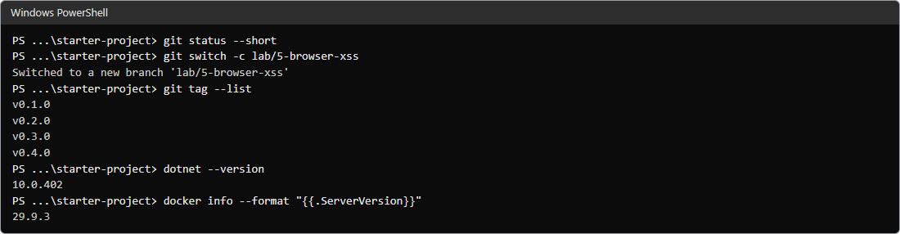

*Рис. 1. Чисте дерево, гілка lab/5-browser-xss, теги попередніх робіт, версії SDK і Docker.*

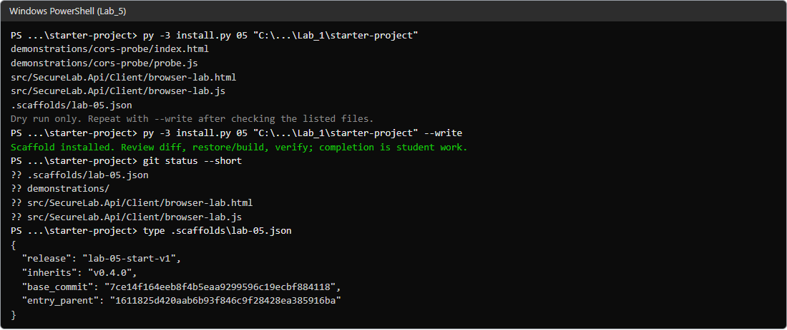

*Рис. 2. Dry run і встановлення scaffold lab-05-start-v1, квитанція .scaffolds/lab-05.json.*

Перед роботою я переконався, що scaffold нічого не зламав. Збірка пройшла без помилок і попереджень, reset створив seed, 66 тестів ЛР 4 пройшли, /health відповідає 200 (Рис. 3). Пароль для seed я задавав змінною середовища SeedUsers__Password у терміналі, у Git його немає.

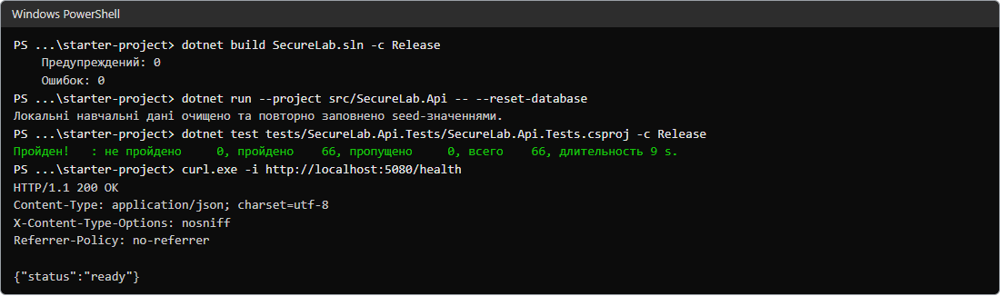

*Рис. 3. Збірка, reset бази, 66 тестів і /health до початку досліду.*

Пакет scaffold додав і другий каталог demonstrations/cors-probe: статичну сторінку, яка робить fetch на абсолютну адресу API. Її я запускав на портах 4173 і 4174 командами py -3 -m http.server 4173 --bind localhost --directory demonstrations/cors-probe і так само для 4174.

## 3. Нормальний flow і карта source-to-sink

Спершу я подивився на звичайну роботу сторінки без payload. Після входу як morgan на /browser-lab.html я прочитав інцидент Bob. Сторінка показує GET: 200, назву, опис і коментар, у Network один запит GET /api/incidents/{id} з JSON (Рис. 4). Саме цей запит відповідає дії «Прочитати».

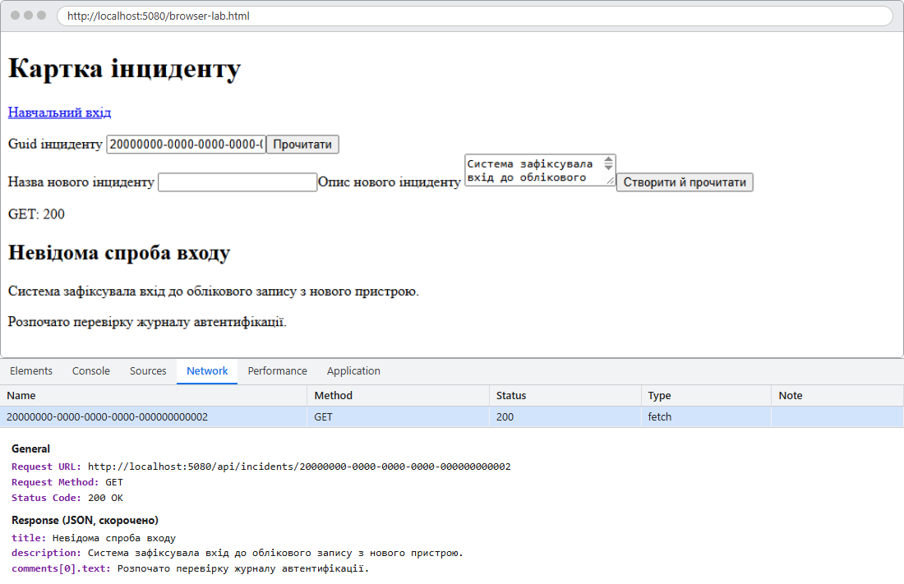

*Рис. 4. Нормальний flow: Morgan читає інцидент Bob, GET /api/incidents/{id} повертає 200 і JSON.*

Карту я зберіг у docs/source-to-sink.md. Для Description кожен крок має конкретне поле, файл і функцію (таблиця 2). Висновок один: значення з поля форми проходить через PostgreSQL і JSON без жодного очищення від HTML, а в браузері потрапляє в innerHTML.

Таблиця 2. Карта source-to-sink для Incident.Description.

| Крок | Файл і функція / DTO | Поле / значення | Доказ і довіра |
|---|---|---|---|
| Source | browser-lab.html, <textarea name="description"> у формі #edit | рядок від користувача | контрольоване користувачем |
| Request | browser-lab.js, submit форми: fetch("/api/incidents", POST) | JSON-поле description | Network: POST 201, у payload marker |
| Validation | Scaffolding/Lab02Endpoints.cs, CreateIncidentRequest.Description | обов'язковий, до 4000 символів, Trim() | перевірка формату; значення не стає довіреним |
| Storage | таблиця incidents, колонка description | marker без змін | psql (Рис. 11); збережене значення користувача |
| Response | IncidentQueries.GetDetailsAsync, IncidentDetailsResponse.Description | JSON-поле description | Network: GET 200, те саме значення; недовірене |
| Client transform | browser-lab.js, load(): current = await response.json() | current.description | без перетворень |
| Sink / context | browser-lab.js, load(): #description.innerHTML = current.description | елемент 
 | небезпечний sink, контекст HTML parser |

Це stored XSS, бо значення спершу зберігається в БД і виконується під час пізнішого перегляду, і водночас DOM-based за місцем перетворення: небезпечну операцію виконує JavaScript клієнта через innerHTML. Reflected XSS я не відтворював, у спільному scope окремого reflected flow немає.

Для рівня «Добре» я додав другий потік, IncidentComment.Text (таблиця 3). Endpoint створення коментаря в API немає, тому source на стенді це seed-коментар 30000000-0000-0000-0000-000000000005 від Morgan до інциденту Alice. У DbSeeder.SeedAsync я додав константу з marker і ще один IncidentComment в AddRange. Існуючі коментарі, зокрема internal 30000000-…-0003 з ЛР 4, не змінював.

Таблиця 3. Другий потік: IncidentComment.Text.

| Крок | Файл і функція / DTO | Поле / значення | Доказ і довіра |
|---|---|---|---|
| Source | Data/DbSeeder.cs, SeedAsync, константа Lab05Marker | IncidentComment.Text | синтетичний seed; у продукті контрольоване користувачем |
| Request / validation | відсутні: коментар через API не створюється |  |  |
| Storage | таблиця incident_comments, колонка text | marker без змін | psql |
| Response | IncidentQueries.GetDetailsAsync, IncidentCommentResponse.Text; internal відфільтровано для Reporter | comments[].text | Network: GET 200; недовірене |
| Client transform | browser-lab.js, load(): цикл for (const comment of current.comments) | comment.text | без перетворень |
| Sink / context | browser-lab.js, load(): paragraph.innerHTML = comment.text | абзац 
 у #comments | небезпечний sink, HTML parser |

### 3.1. Інвентаризація DOM sinks

Я перевірив увесь каталог src/SecureLab.Api/Client пошуком innerHTML, outerHTML, insertAdjacentHTML, eval, new Function, inline event handlers, href і src. Пошук був лише початком: кожне місце я розібрав за походженням даних і контекстом (таблиця 4). innerHTML зустрічається рівно двічі, обидва місця в browser-lab.js. Приховані sinks в app.js і auth-lab.js відсутні, там усе виводиться через textContent. Посилань з даних, динамічних атрибутів і сторонніх скриптів у клієнті немає.

Таблиця 4. Інвентаризація sinks у Client/.

| Місце | Категорія даних | Контекст | Рішення |
|---|---|---|---|
| browser-lab.js: #title.textContent = current.title | збережене значення користувача | текстовий вузол | безпечно, лишаю |
| browser-lab.js: #description.innerHTML = current.description | збережене значення користувача | HTML parser | небезпечно, замінити safe helper |
| browser-lab.js: paragraph.innerHTML = comment.text | збережене значення користувача | HTML parser | небезпечно, замінити тим самим helper |
| browser-lab.js: #status.textContent = `GET: ${response.status}` | server-generated | текстовий вузол | безпечно |
| browser-lab.js: поле форми .value = current.description | збережене значення користувача | властивість value, не HTML | безпечно |
| browser-lab.html: статичний шаблон | trusted constant | HTML | допустимо, даних користувача немає |
| app.js: createTextElement(..., textContent) | збережене значення користувача | текстовий вузол | безпечно (innerHTML там немає з ЛР 4) |
| auth-lab.js: renderProfile через textContent | server-generated | текстовий вузол | безпечно |
| href, src з даних; eval; new Function | не використовуються | URL, code | відсутні |

## 4. Звичайний текст до PoC

Перш ніж брати marker, я створив через форму «Створити й прочитати» п'ять звичайних значень Description і подивився на фактичний DOM на vulnerable коді. Звичайні слова, лапки й Unicode не відрізняють безпечне відображення від небезпечного. Різницю дають лише рядки, схожі на теги: <b>жирний</b> текст на сторінці вже без дужок, а в Elements з'являється справжній елемент <b> (Рис. 6). Seed-інцидент 20000000-…-0003 з текстом <script> показує лише слово «Текст», решта речення опинилася всередині невиконаного елемента <script> (Рис. 7).

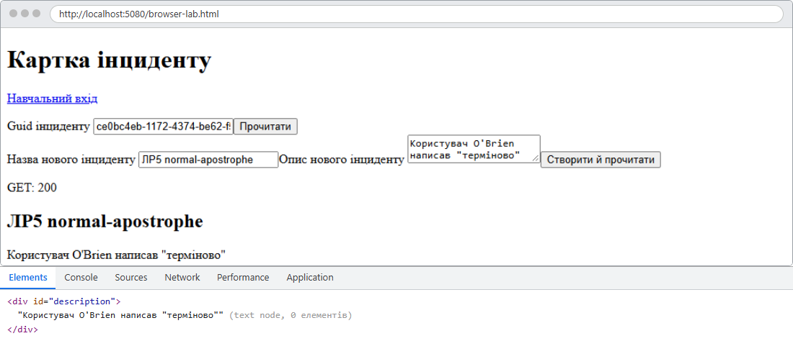

*Рис. 5. Vulnerable: апостроф і лапки показано як текст, дочірніх елементів немає.*

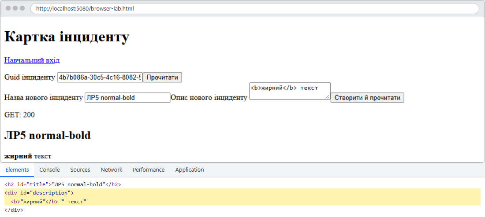

*Рис. 6. Vulnerable: <b>жирний</b> текст перетворився на елемент <b>, дужок не видно.*

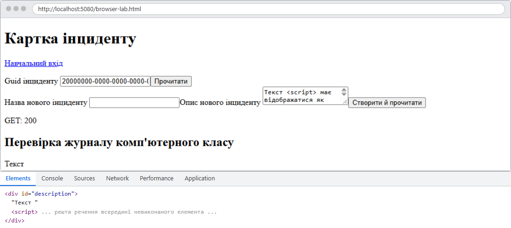

*Рис. 7. Vulnerable: seed-інцидент з <script> показує лише слово «Текст».*

Таблиця 5. Нормальні значення на vulnerable коді (фактично).

| Значення в описі | Що в DOM до виправлення | Дочірніх елементів |
|---|---|---|
| Користувач O'Brien написав "терміново" | один текстовий вузол, текст збігається | 0 |
| 5 < 7 і 9 > 3 | один текстовий вузол, < перед пробілом не початок тегу | 0 |
| Київ — Ω | один текстовий вузол, Unicode цілий | 0 |
| <b>жирний</b> текст | елемент <b> і текстовий вузол, дужок немає | 1 |
| 4000 символів (максимум за валідацією ЛР 2) | один текстовий вузол, довжина 4000 | 0 |

## 5. Вразливий стан: відтворення

Тепер я працював із vulnerable commit 0ea0de4. Перед кожним повтором я оновлював сторінку, бо атрибут marker лишається на елементі до перезавантаження.

### 5.1. Stored XSS в описі

У вікні Alice я виконав команду перевірки в Console: до досліду вона повертає null (Рис. 8). Потім ввів нейтральну назву, вставив marker з lab05-marker.txt в порожнє поле опису й натиснув «Створити й прочитати». Статус GET: 200, замість тексту на сторінці значок «зламаного» зображення. У Network є POST /api/incidents зі статусом 201 і marker у payload, GET /api/incidents/{id} зі статусом 200 і запит x, тобто спроба завантажити картинку (Рис. 9). В Elements усередині #description з'явився елемент , а на #lab05-marker-target виник атрибут data-lab05-marker="executed"; команда перевірки повернула 'executed' (Рис. 10).

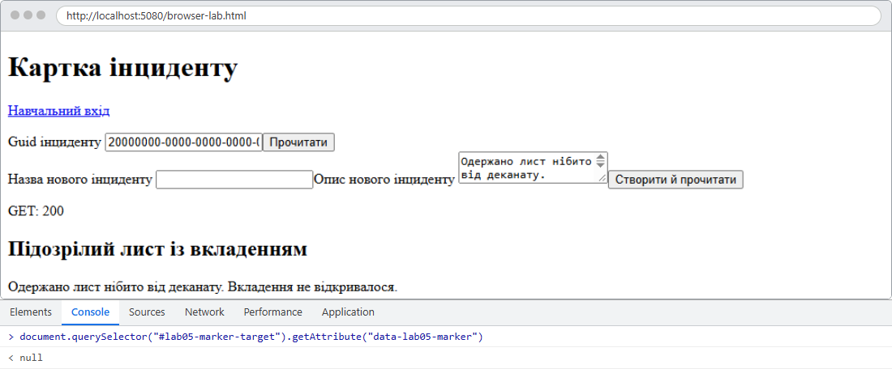

*Рис. 8. Перед створенням запису команда перевірки marker повертає null.*

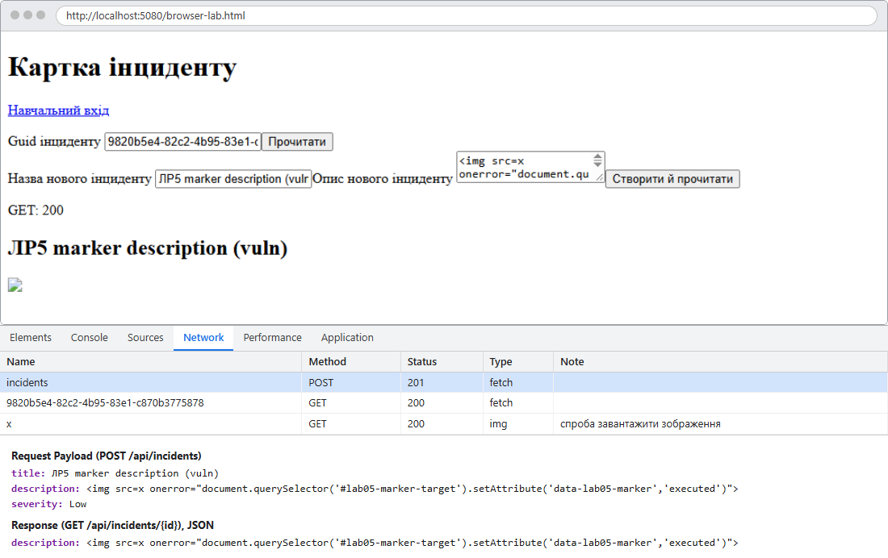

*Рис. 9. Vulnerable: Alice створює запис з marker, на сторінці зламане зображення; у Network POST 201, GET 200 і запит x.*

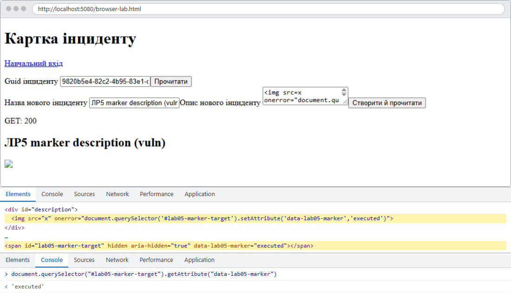

*Рис. 10. Vulnerable: в #description елемент , на контрольному span data-lab05-marker="executed".*

Значення в базі я перевірив окремо через psql: у колонці description збережено рівно рядок marker, нічого не вирізано і не замінено (Рис. 11). Тобто збереження не змінює походження значення, воно залишається недовіреним.

*Рис. 11. База даних: incidents.description і incident_comments.text містять marker без змін.*

### 5.2. Виконання в сеансі Morgan і контроль Bob

Це і є доказ саме stored XSS: код, який записала Alice, виконався в іншому сеансі. Я відкрив окреме вікно з чистими cookie, увійшов як morgan (Analyst), перед запитом команда перевірки повернула null, після GET: 200 для Guid запису Alice вона повернула 'executed' (Рис. 12). Контроль: Bob отримує GET: 404 за матрицею ЛР 4, marker лишається null (Рис. 13). Bob не є доказом XSS, лише підтверджує, що авторизація ЛР 4 працює.

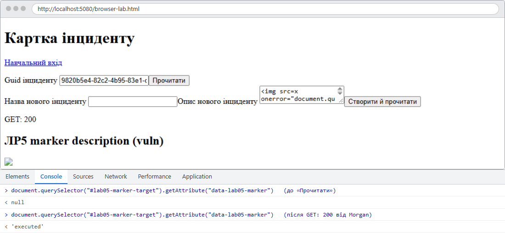

*Рис. 12. Vulnerable: у сеансі Morgan marker виконується після читання запису Alice.*

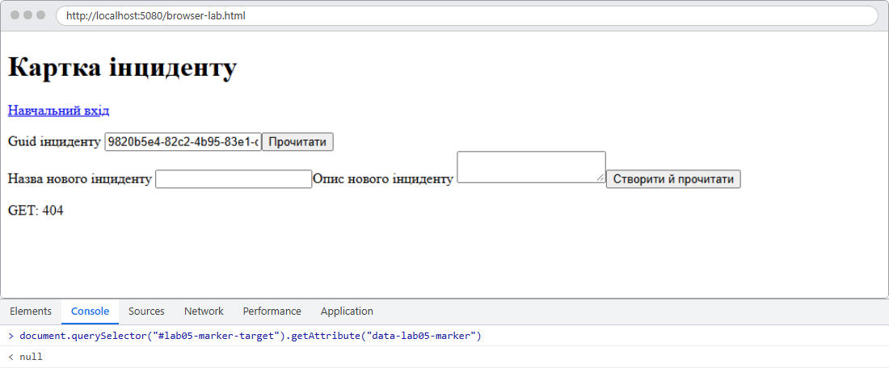

*Рис. 13. Контроль: Bob не бачить чужий запис (GET: 404), marker null.*

### 5.3. Другий sink: IncidentComment.Text

Після reset із новим seed Alice відкрила власний інцидент 20000000-…-0001. Публічний коментар …-0005 містить marker. До виправлення в #comments є елемент , а команда перевірки повертає 'executed' ще до будь-яких дій з описом (Рис. 14).

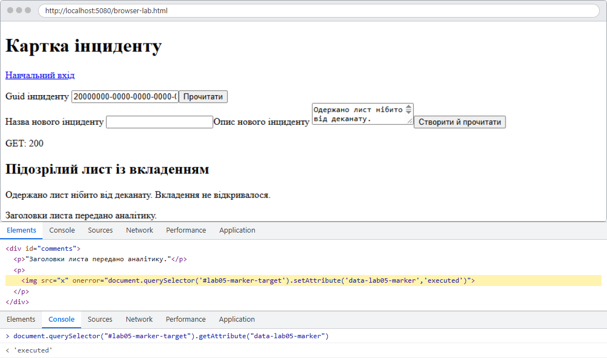

*Рис. 14. Vulnerable: marker у seed-коментарі виконується під час відображення коментарів.*

### 5.4. DOM-тест на vulnerable

Для відмінного рівня я зберіг тест tests/browser/description-dom.js, який запускається в Console справжнього браузера на /browser-lab.html і перевіряє фактичний DOM. Тест створює запис з marker, перевіряє textContent і відсутність елементів в описі, двічі перевантажує сторінку, перевіряє кожен comments[].text і позитивні рядки з таблиці 5. На vulnerable commit він дає FAIL: 8 з 15 перевірок не пройдено (Рис. 15). Тест падає на самому sink незалежно від CSP, бо дивиться на елементи, а не лише на виконання marker.

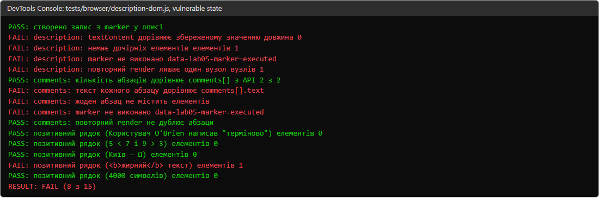

*Рис. 15. DOM-тест на vulnerable: RESULT: FAIL.*

## 6. Причина та finding

Причину я шукав у конкретному коді, а не в payload. Функція load() у browser-lab.js бере дані з відповіді API і двічі присвоює їх властивості innerHTML (Рис. 16). Властивість innerHTML віддає рядок HTML parser, тож символи значення стають синтаксисом, а не даними. Сервер при цьому поводиться правильно: авторизація ЛР 4 працює, значення зберігається як звичайний текст.

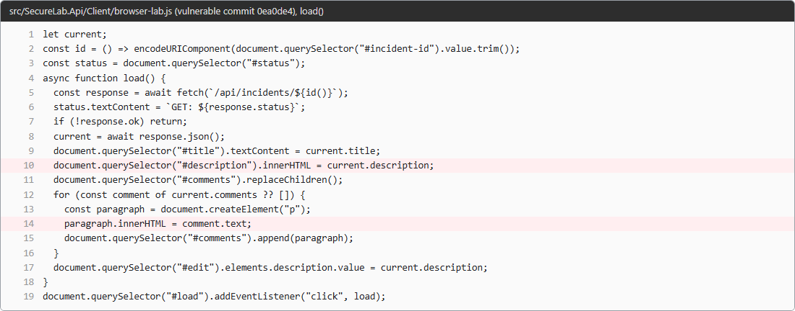

*Рис. 16. Vulnerable commit: два присвоєння innerHTML у load() (виділено).*

Таблиця 6. Finding: stored XSS через innerHTML.

| Пункт | Опис |
|---|---|
| Актив | сеанс браузера і дані, доступні від імені користувача (Analyst Morgan читає записи інших користувачів) |
| Передумови | тестовий акаунт, який може створити інцидент (Alice), контроль над текстовим полем; привілейований глядач відкриває запис |
| Першопричина | недовірене значення з API потрапляє в HTML-контекст: #description.innerHTML = current.description і paragraph.innerHTML = comment.text у browser-lab.js, функція load() |
| Вплив на стенді | marker виконав лише безпечну локальну дію: атрибут на #lab05-marker-target, у сеансі Alice, у сеансі Morgan і для seed-коментаря |
| Виправлення | контекстно безпечне виведення: текстовий вузол через єдиний helper renderPlainText для Description і для коментарів; значення в БД не змінюється |
| Retest | той самий marker, той самий запис, той самий порядок дій; DOM-тест FAIL → PASS |
| Залишковий ризик | нові місця виведення в майбутньому; сторонній код; CSP лише додатковий шар, а не виправлення sink |

Фільтр на кшталт value.replace("script", "") я не розглядав як виправлення: marker працює без слова script, обробник onerror виконується без <script>. Забороняти кутові дужки теж не можна, бо 5 < 7 і <b> у тексті це звичайні дані. Sanitizer тут не потрібен: formatted HTML у Description і IncidentComment.Text за умовою завдання не дозволено, обидва поля є звичайним текстом.

## 7. Виправлення

Я додав у browser-lab.js одну функцію renderPlainText(target, text). Вона замінює вміст контейнера одним текстовим вузлом через replaceChildren(document.createTextNode(...)). Структуру елементів задає код (абзаци створює createElement), а дані потрапляють лише в текстовий вузол. replaceChildren очищає контейнер перед вставкою, тому повторний render не дублює вміст. Обидва місця, опис і коментарі, викликають цей самий helper (Рис. 17), тож innerHTML у файлі більше немає.

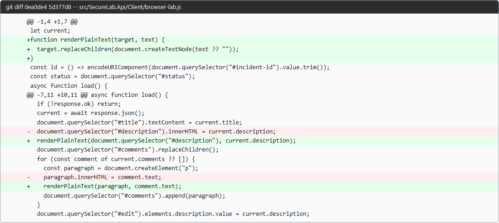

*Рис. 17. Виправлення: єдиний helper renderPlainText замінює обидва innerHTML.*

Дані на вході я не чіпав: валідація ЛР 2 не змінена, значення зберігається як є. Виправлення стоїть там, де браузер інтерпретує дані, тобто в sink.

## 8. Повторна перевірка після виправлення

Я повторив ті самі дії: той самий marker, ті самі вікна Alice, Morgan і Bob, той самий seed-коментар. Далі показано стан на fixed commit.

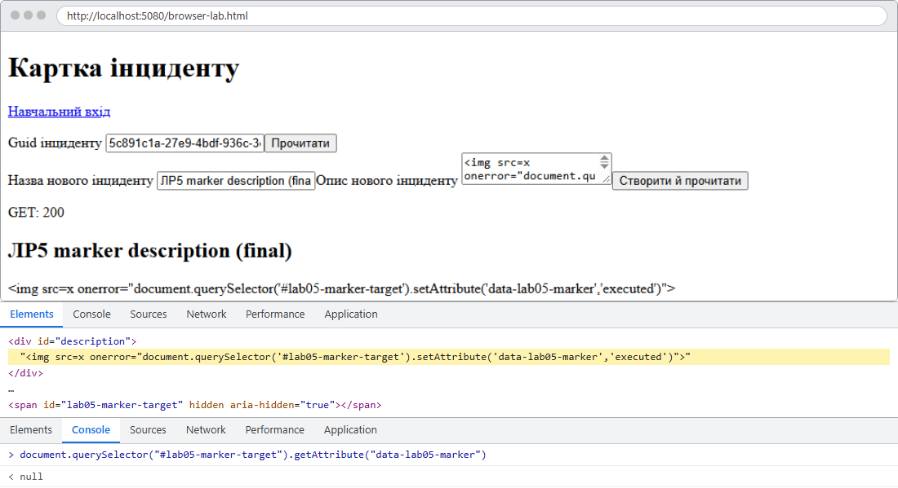

*Рис. 18. Fixed: marker показано як текст, в #description один текстовий вузол,  немає, команда перевірки повертає null.*

На сторінці видно сам рядок marker символ у символ. В Elements усередині #description текстовий вузол, елемента  немає, запиту x у Network немає, команда перевірки повертає null (Рис. 18). Значення в базі й у відповіді API таке саме, як було до виправлення, змінилося лише відображення (Рис. 19, 20).

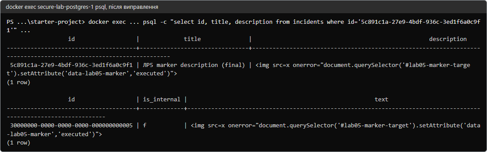

*Рис. 19. Fixed: у базі той самий marker, що й на vulnerable.*

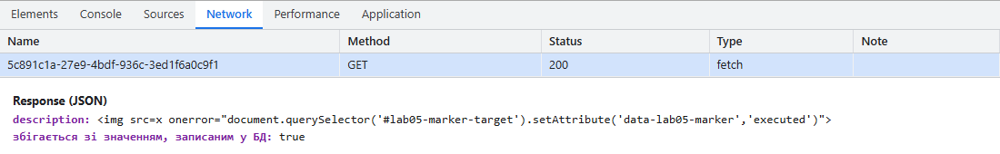

*Рис. 20. Fixed: JSON відповіді містить marker без змін.*

Для Morgan marker більше не виконується (Рис. 21), Bob, як і раніше, отримує 404 (Рис. 22). Seed-коментар відображається як текст, у #comments немає елемента  (Рис. 23).

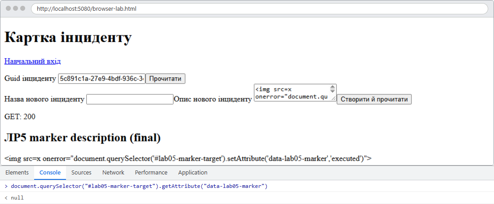

*Рис. 21. Fixed: у сеансі Morgan marker не виконується, значення null.*

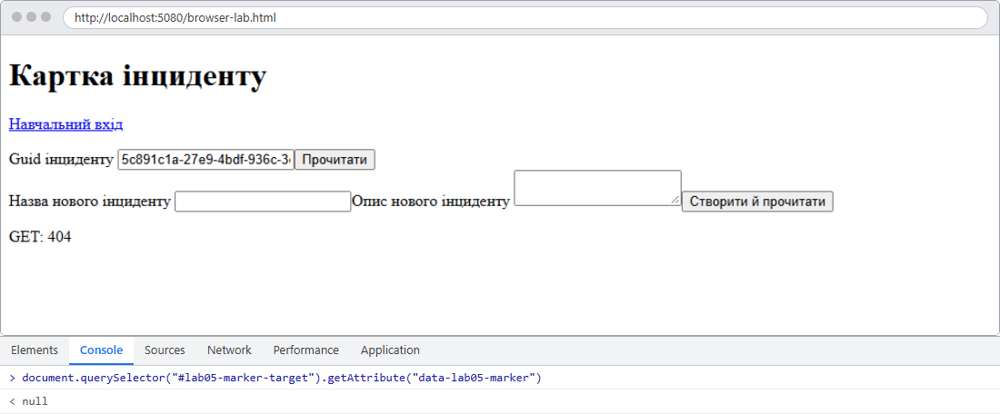

*Рис. 22. Fixed: контроль Bob, GET: 404, marker null.*

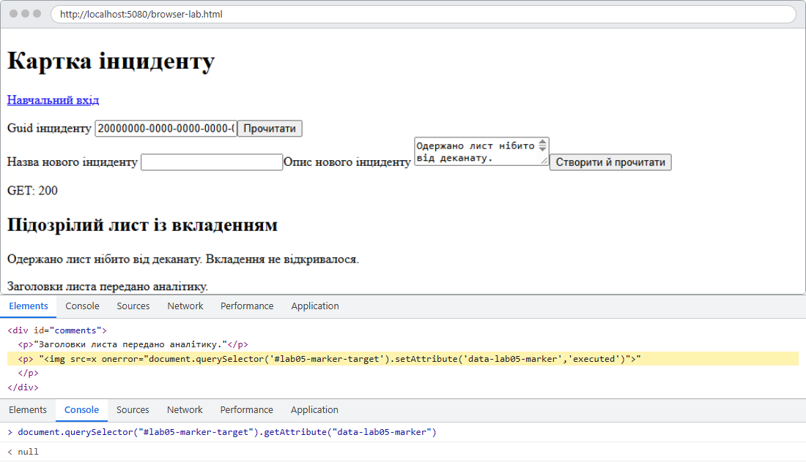

*Рис. 23. Fixed: marker у коментарі показано як текст, команда перевірки повертає null.*

Нормальні значення з таблиці 5 після виправлення відображаються як текст, а <b>жирний</b> текст тепер видно з дужками, в Elements один текстовий вузол (Рис. 24). Seed-інцидент з <script> показує все речення (Рис. 25). Апостроф, лапки, < і >, Unicode і 4000 символів працюють без пошкодження (Рис. 26; довгий рядок і решту перевіряє DOM-тест).

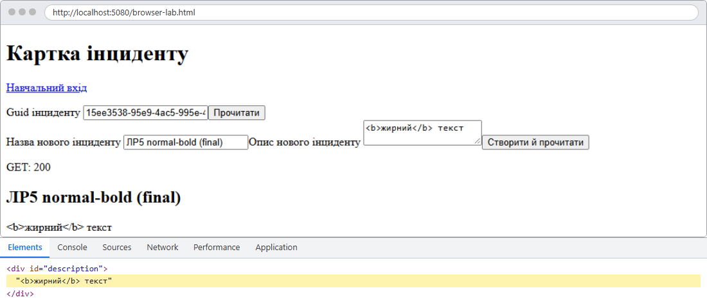

*Рис. 24. Fixed: <b>жирний</b> текст показано як є, в Elements один текстовий вузол.*

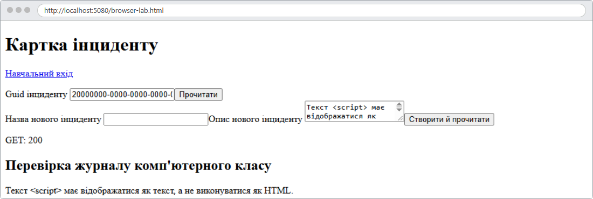

*Рис. 25. Fixed: seed-інцидент з <script> показує все речення.*

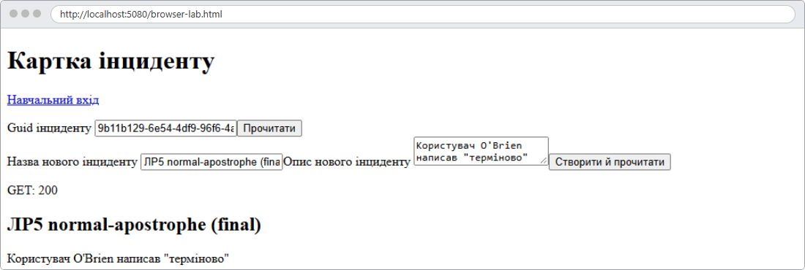

*Рис. 26. Fixed: апостроф і лапки відображаються без змін.*

DOM-тест на fixed commit проходить: 15 з 15 перевірок PASS, тобто Description і кожен comments[].text стали текстовими вузлами, повторний render не дублює вміст, позитивні рядки показано без пошкоджень (Рис. 27).

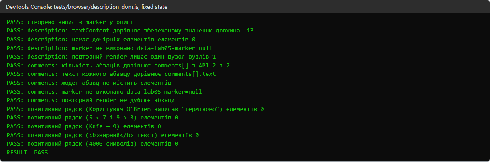

*Рис. 27. DOM-тест на fixed: RESULT: PASS.*

Таблиця 7. До → першопричина → fix → retest → залишковий ризик.

| Що | До | Причина і fix | Retest | Залишковий ризик |
|---|---|---|---|---|
| Description | marker виконується,  в DOM | innerHTML → renderPlainText | текстовий вузол, null, БД незмінна | нові екрани виведення |
| IncidentComment.Text | marker виконується,  в #comments | той самий helper | текст, null | те саме |
| Звичайні рядки | <b> стає елементом | текстовий вузол | усі 5 значень як текст | немає |
| Morgan (Analyst) | executed | виправлено sink | null | немає |

## 9. Origin, CORS і межі browser credentials

### 9.1. Origins і прогноз

Origin це схема, host і порт. Тому http://localhost:5080, http://localhost:4173 і http://localhost:4174 це три різні origins. Перед зміною конфігурації я записав прогноз, а потім звірив його зі спостереженнями (таблиця 8).

Таблиця 8. Прогноз і фактичний результат до policy.

| Сценарій | Доходить до API? | JavaScript читає response? | Факт і причина |
|---|---|---|---|
| same-origin 5080 → API | так | так | CORS не потрібен, штатний клієнт працює (Рис. 9) |
| simple GET 4173 → API | так | ні | у Network GET із Origin і блокування читання, MissingAllowOriginHeader (Рис. 28) |
| запит із заголовком 4173 → API | доходить лише OPTIONS | ні | OPTIONS 405 без Access-Control-*, actual GET не надіслано (Рис. 29) |
| simple GET 4174 → API | так | ні | та сама відмова, Origin не в allowlist |
| curl / .http → API | так | не застосовується | це не browser JavaScript, SOP не діє |

### 9.2. Стан до policy

На сторінках 4173 і 4174 я виконав у Console простий запит до /health із абсолютною адресою API. Обидва завершилися TypeError: Failed to fetch, а в Console причина: No 'Access-Control-Allow-Origin' header is present on the requested resource. Запит дійшов до API з заголовком Origin, але у відповіді немає Access-Control-Allow-Origin (Рис. 28). Запит із нестандартним заголовком X-Lab-Cors-Probe спричиняє preflight: OPTIONS отримав 405, браузер actual GET не надіслав (Рис. 29).

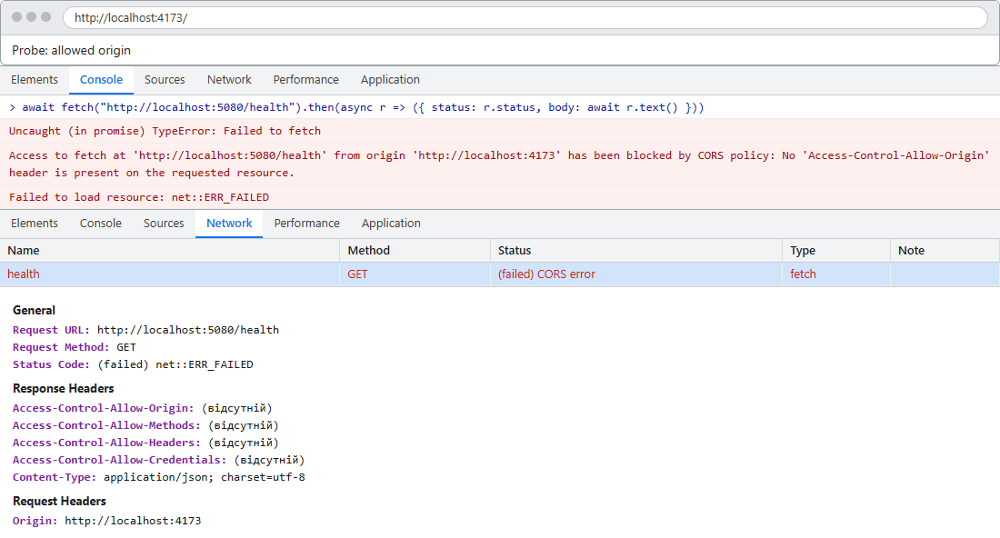

*Рис. 28. До policy: простий GET із 4173 заблоковано, у відповіді немає Access-Control-Allow-Origin.*

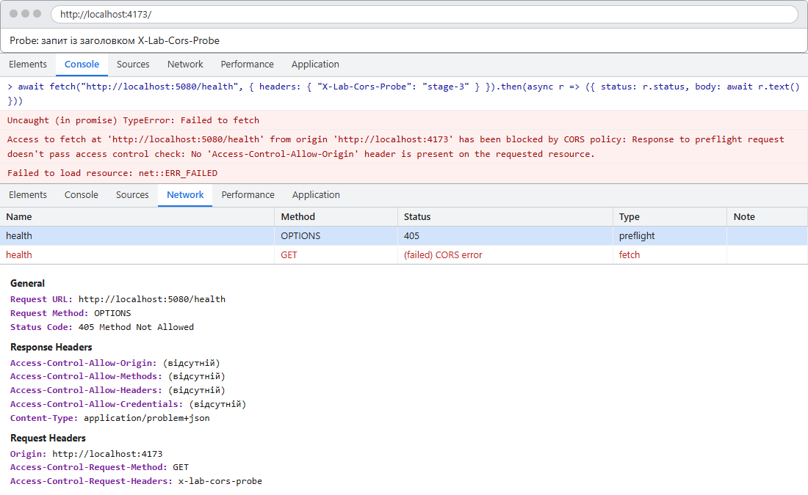

*Рис. 29. До policy: preflight OPTIONS із 4173 повертає 405, actual GET не надіслано.*

### 9.3. Policy Lab05BrowserProbe

У Program.cs я додав policy, яка реєструється й застосовується тільки в Development. Вона дозволяє єдиний origin http://localhost:4173, метод GET і заголовок X-Lab-Cors-Probe, а для cookie-досліду ще AllowCredentials() (Рис. 30). Я не використовував AllowAnyOrigin, AllowAnyMethod, AllowAnyHeader і не відбиваю довільний Origin. UseRouting() і UseCors стоять перед UseAuthentication і UseAuthorization, щоб CORS-заголовки були й у відповідях 401 і 403.

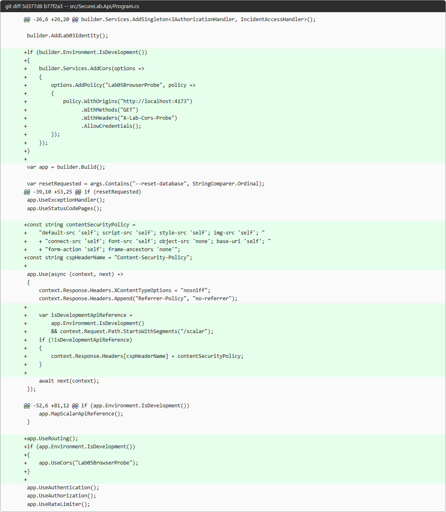

*Рис. 30. Program.cs: CORS-policy (Development), UseRouting/UseCors до authentication, CSP у спільній middleware.*

### 9.4. Простий запит і preflight після policy

З 4173 простий запит повертає {status: 200, body: '{"status":"ready"}'}, у відповіді Access-Control-Allow-Origin: http://localhost:4173 (Рис. 31). Для запиту з заголовком браузер спершу надсилає OPTIONS із Origin, Access-Control-Request-Method: GET і Access-Control-Request-Headers: x-lab-cors-probe. Відповідь 204 містить Allow-Origin, Allow-Methods: GET і Allow-Headers: X-Lab-Cors-Probe, після чого йде actual GET 200 (Рис. 32).

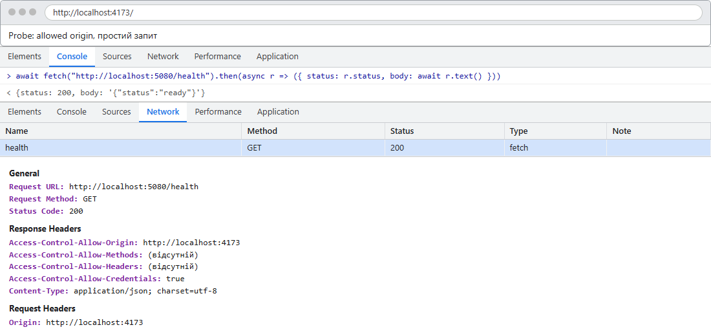

*Рис. 31. Allowed origin 4173: простий GET, 200 і Access-Control-Allow-Origin.*

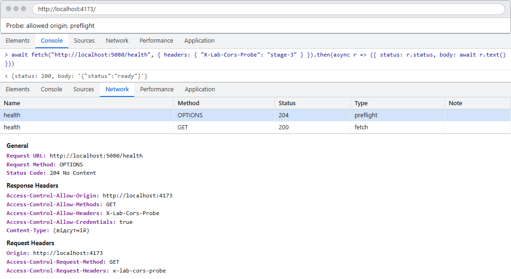

*Рис. 32. Allowed origin 4173: OPTIONS 204 з трьома Allow-* і actual GET 200.*

З 4174 той самий простий запит знову дає TypeError: у відповіді немає жодного Access-Control-*, браузер не віддає її сторінці (Рис. 33). Для запиту із заголовком OPTIONS теж повертає 204, але без Access-Control-*, тому actual GET не надіслано (Рис. 34). Статус 204 сам по собі нічого не доводить, різницю дають лише заголовки.

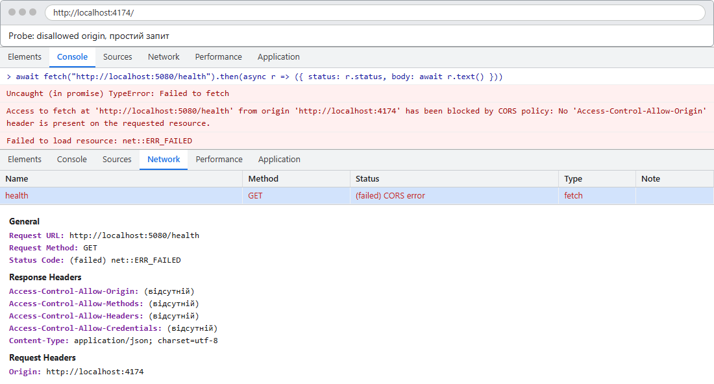

*Рис. 33. Disallowed origin 4174: простий GET, відповідь без Allow-Origin, JavaScript її не читає.*

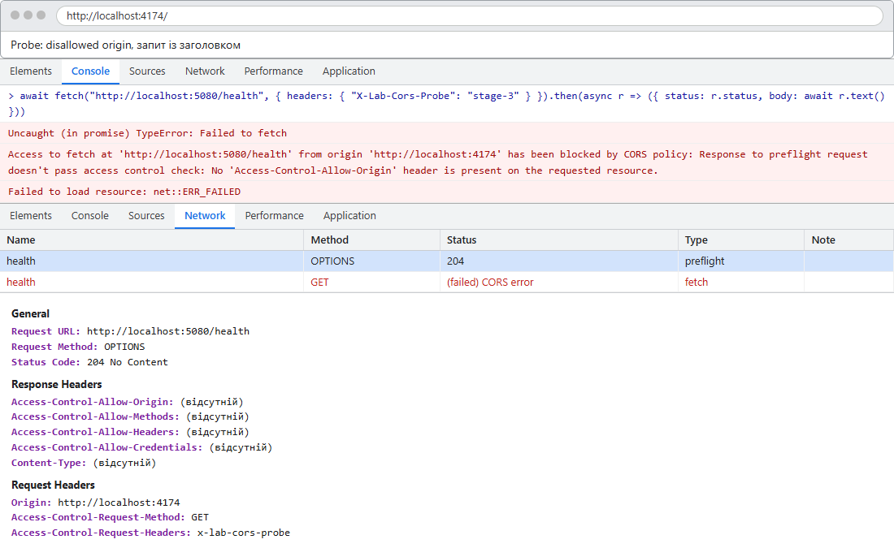

*Рис. 34. Disallowed origin 4174: OPTIONS 204 без Access-Control-*, actual GET не надіслано.*

Щоб перевірити порядок middleware, я зробив із 4173 запит без cookie до захищеного /api/incidents. Результат 401: JavaScript прочитав саме HTTP-відмову, отже CORS-заголовки є й у відповіді 401 (Рис. 35).

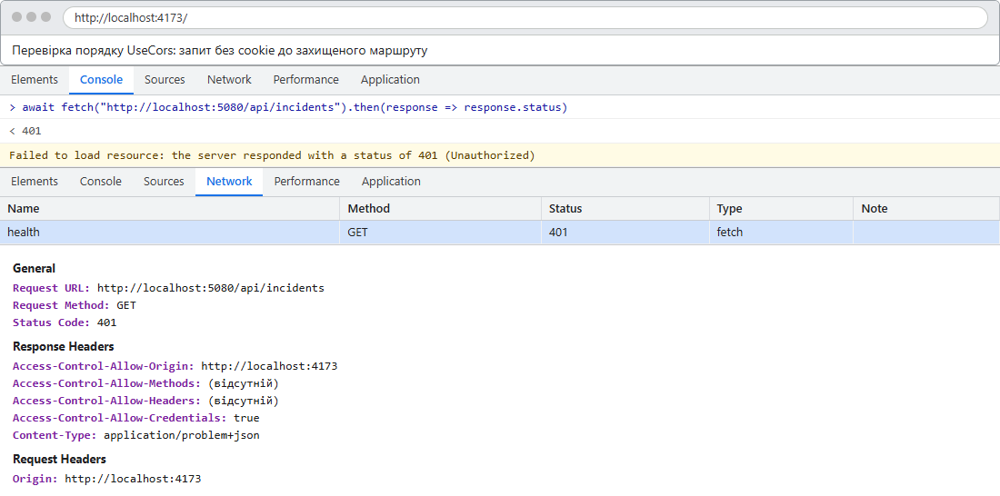

*Рис. 35. Порядок UseCors: запит без cookie з 4173 повертає читабельний 401.*

Таблиця 9. Матриця після policy (фактично).

| Origin і запит | Що дійшло до API | Що бачить JavaScript | Доказ |
|---|---|---|---|
| 4173, простий GET | GET | response 200 | Allow-Origin: http://localhost:4173 (Рис. 31) |
| 4173, із заголовком | OPTIONS, потім GET | response 200 | OPTIONS 204 і GET 200 (Рис. 32) |
| 4174, простий GET | GET дійшов | нічого, TypeError | CORS error; API-журнал у розділі 9.6 (Рис. 33) |
| 4174, із заголовком | лише OPTIONS | нічого, TypeError | OPTIONS 204 без Access-Control-*, GET не надіслано (Рис. 34) |

### 9.5. Credentials і cookie

Кнопка GET на сторінці probe надсилає запит із credentials: "include". Після входу Alice на 5080 я натиснув її на 4173: відповідь 200 зі списком інцидентів, у Network запит несе Cookie (значення я не показую) і Origin, а відповідь містить Access-Control-Allow-Origin: http://localhost:4173 і Access-Control-Allow-Credentials: true (Рис. 36). На 4174 у тому самому сеансі браузер не надав response JavaScript, у Console немає Allow-Origin (Рис. 37). Cookie при цьому надіслано й запит виконано, браузер лише не показав відповідь сторінці. Тому CORS не захищає ресурс, а лише керує читанням.

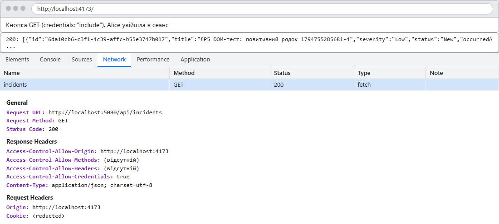

*Рис. 36. Cookie-дослід із 4173: 200, точний Allow-Origin і Allow-Credentials: true.*

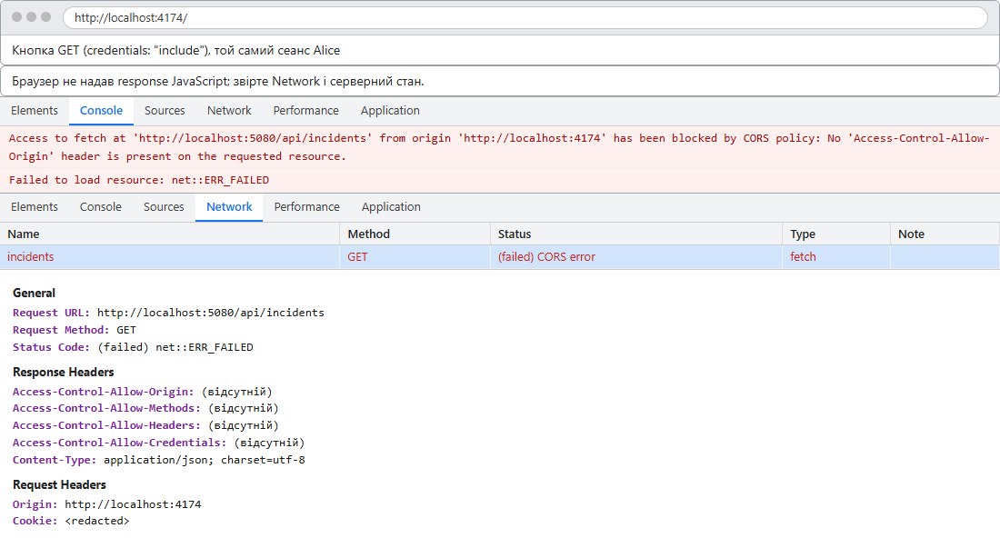

*Рис. 37. Cookie-дослід із 4174: запит надіслано з cookie, але response сторінці не надано.*

Негативний контроль: у policy без AllowCredentials() той самий запит із 4173 відхиляється з повідомленням про Access-Control-Allow-Credentials, яке має бути true (Рис. 38). Тобто credentials: "include" у fetch і AllowCredentials() на сервері працюють лише разом. Без входу, у приватному вікні, з 4173 JavaScript читає 401 із CORS-заголовками (Рис. 39). Ці два порти localhost це різні origins, але один site, тому цей дослід не доводить поведінку SameSite=Lax. Cookie сеансу має ознаки HttpOnly, SameSite=Lax, Secure немає, бо стенд працює по HTTP.

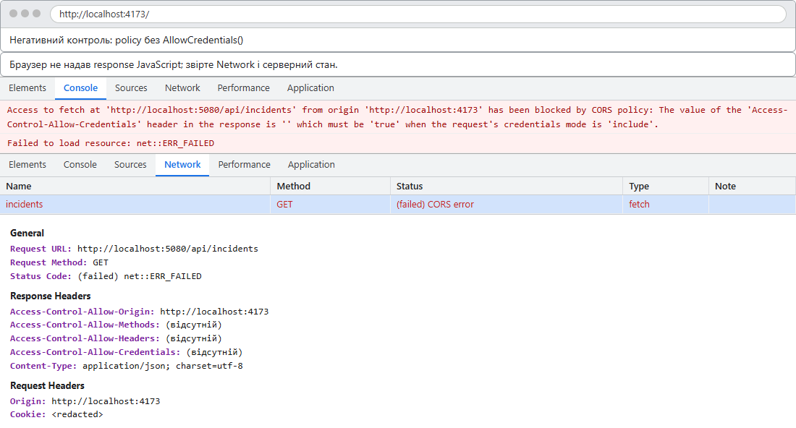

*Рис. 38. Без AllowCredentials(): відмова через Access-Control-Allow-Credentials.*

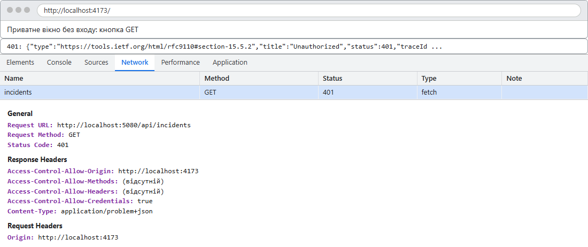

*Рис. 39. Без входу з 4173: JavaScript читає HTTP-відмову 401, CORS-заголовки є.*

Я не комбінував AllowAnyOrigin з AllowCredentials: wildcard несумісний із credentialed response, а ASP.NET Core відхиляє таку policy ще на старті. AllowCredentials() лишився тільки в Development policy для єдиного origin 4173.

### 9.6. Browser і direct HTTP

Той самий scenario поза браузером я виконав через curl.exe. Для Origin 4173 відповідь містить Access-Control-Allow-Origin: http://localhost:4173 і Allow-Credentials, для Origin 4174 жодного Access-Control-*, але статус в обох 200, бо сервер запит виконав (Рис. 40). Preflight із curl так само дає 204 з Allow-* лише для 4173 (Рис. 41). Запит до захищеного /api/incidents без cookie повертає 401 навіть з Origin 4174: працює authentication, а не CORS (Рис. 42).

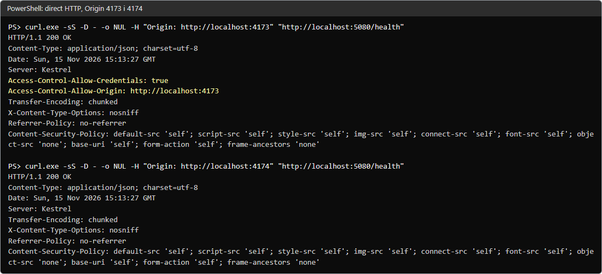

*Рис. 40. curl.exe: /health з Origin 4173 і 4174, видно різницю в Access-Control-*.*

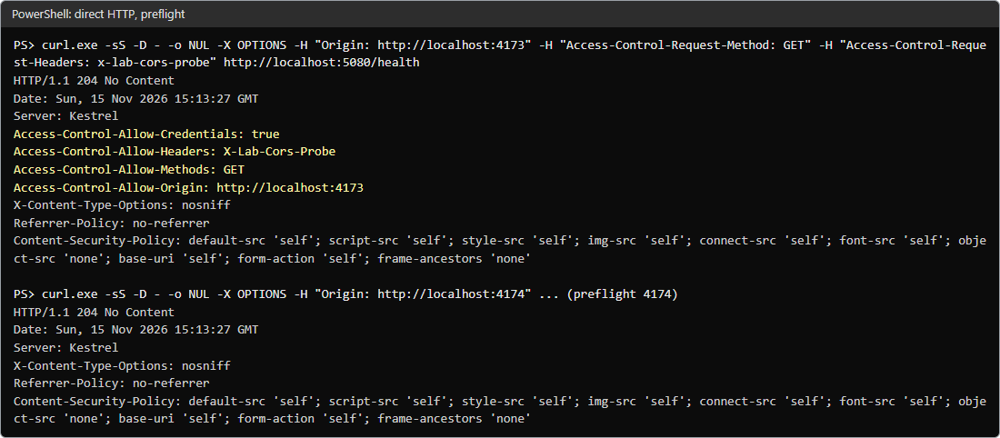

*Рис. 41. curl.exe: preflight для 4173 (три Allow-*) і для 4174 (без Access-Control-*).*

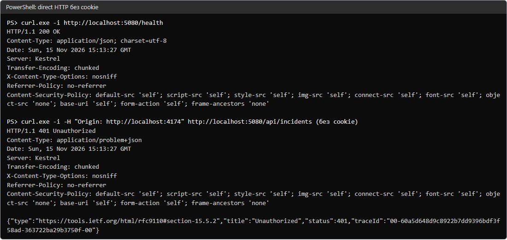

*Рис. 42. curl.exe: /health без Origin і захищений маршрут без cookie (401).*

Що запит із 4174 справді дійшов до API, видно і з боку сервера. Після одного простого запиту з 4174, який браузер заблокував, у журналі API з'явився ще один виклик перевірки БД з /health, лічильник зріс з 10 до 11 (Рис. 43). Отже CORS не зупинив запит, а лише заборонив сторінці читати відповідь.

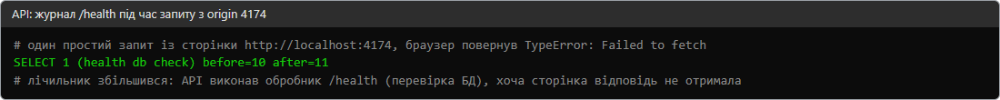

*Рис. 43. API-журнал: заблокований браузером запит із 4174 виконано сервером.*

Таблиця 10. Browser і direct HTTP.

| Клієнт | Статус / API-доказ | Response доступний сторінці | Що застосовано |
|---|---|---|---|
| same-origin 5080 | 200 | так | authentication і authorization; CORS не потрібен |
| browser з allowed 4173 | 200, Allow-Origin 4173 | так | CORS і незалежні API controls |
| browser з disallowed 4174 | GET виконано (журнал API), preflight 204 без Allow-* | ні | SOP/CORS у браузері |
| curl / .http | 200 для /health, 401 без cookie для /api/incidents | клієнт читає HTTP | API controls, без SOP/CORS |

### 9.7. Кінцевий стан CORS

У fixed state policy Lab05BrowserProbe з точним origin http://localhost:4173 лишається в коді, але реєструється й застосовується лише у Development. У Production її немає, і навчальні origins через конфігурацію не додаються. 4174 лишається негативним контролем.

## 10. CSP і browser security headers

Спершу я подивився, звідки клієнт справді завантажує ресурси. Сторінки /, /browser-lab.html і /auth-lab.html підключають лише власні .js і .css з того самого origin, API теж на тому самому origin, зовнішніх hosts, шрифтів і зображень немає. Єдиний виняток це auth-lab.html: у ньому був inline <style>. Щоб не додавати unsafe-inline, я переніс ці стилі в окремий auth-lab.css. З цього побудовано policy (таблиця 11). Довідник /scalar лише в Development завантажує власні сторонні ресурси, тому я виключив його з CSP явно й не послаблюю policy клієнта.

Таблиця 11. CSP за фактичними ресурсами.

| Директива | Фактична потреба | Джерело | Що обмежує |
|---|---|---|---|
| default-src | fallback для решти типів | 'self' | будь-які неявні типи ресурсів |
| script-src | лише власні .js (app.js, auth-lab.js, browser-lab.js) | 'self' | inline-скрипти й обробники подій, чужі host-и |
| style-src | styles.css, auth-lab.css | 'self' | inline-стилі й чужі styles |
| connect-src | fetch до API на тому самому origin | 'self' | з'єднання з іншими origins |
| img-src | зображень немає | 'self' | завантаження картинок з інших host-ів |
| frame-ancestors | вбудовування не потрібне | 'none' | clickjacking через iframe |
| інші | font-src, object-src, base-uri, form-action | 'self' / 'none' | шрифти, плагіни, base і форми |

Політику я додав у наявну спільну middleware заголовків у Program.cs, поруч із nosniff і Referrer-Policy, без другої middleware. Спочатку header мав ім'я Content-Security-Policy-Report-Only. На fixed коді всі три сторінки flow відкриваються з документом 200, а Console без порушень, тобто legitimate flow policy не порушує. Для перевірки policy я зробив одне кероване порушення: new Image().src = "http://localhost:4173/x.png". У режимі report-only Console пише, що завантаження порушує img-src 'self', але policy лише записала порушення й нічого не заблокувала (Рис. 44, 45).

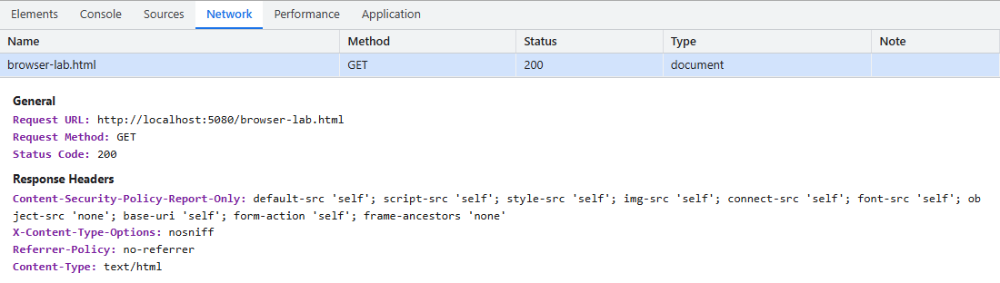

*Рис. 44. Report-only: browser-lab.html 200, Content-Security-Policy-Report-Only, nosniff і no-referrer.*

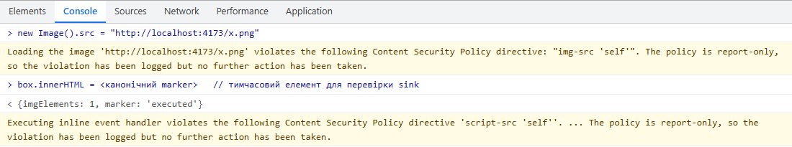

*Рис. 45. Report-only: керовані порушення лише записано, marker через innerHTML на тимчасовому елементі все ще виконується.*

Потім я замінив ім'я header на Content-Security-Policy у тій самій middleware. В enforcement той самий запит позначено як заблокований, а повідомлення закінчується словами The action has been blocked, у Network запис x.png зі статусом blocked:csp (Рис. 46, 47). Три сторінки flow працюють під enforcement так само: список інцидентів, details і вхід (Рис. 48), auth-lab.html зберіг стилі завдяки зовнішньому CSS.

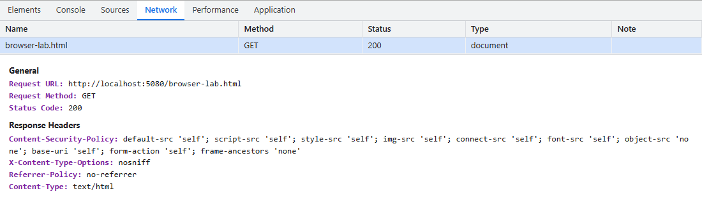

*Рис. 46. Enforcement: Content-Security-Policy без unsafe-inline, frame-ancestors 'none', nosniff, no-referrer.*

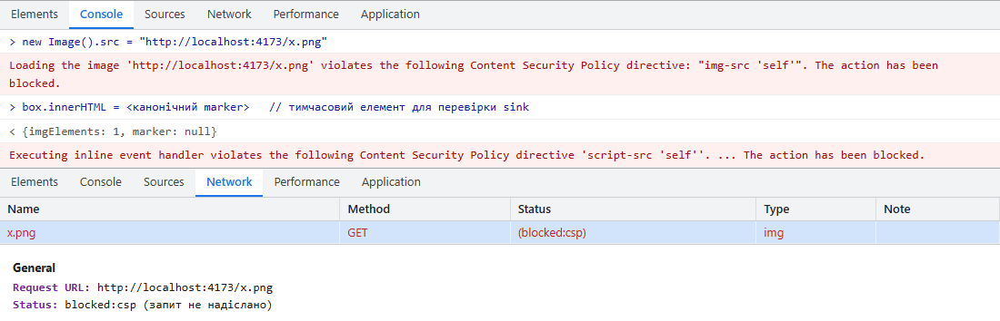

*Рис. 47. Enforcement: порушення заблоковано; inline handler marker не виконується навіть на небезпечному sink.*

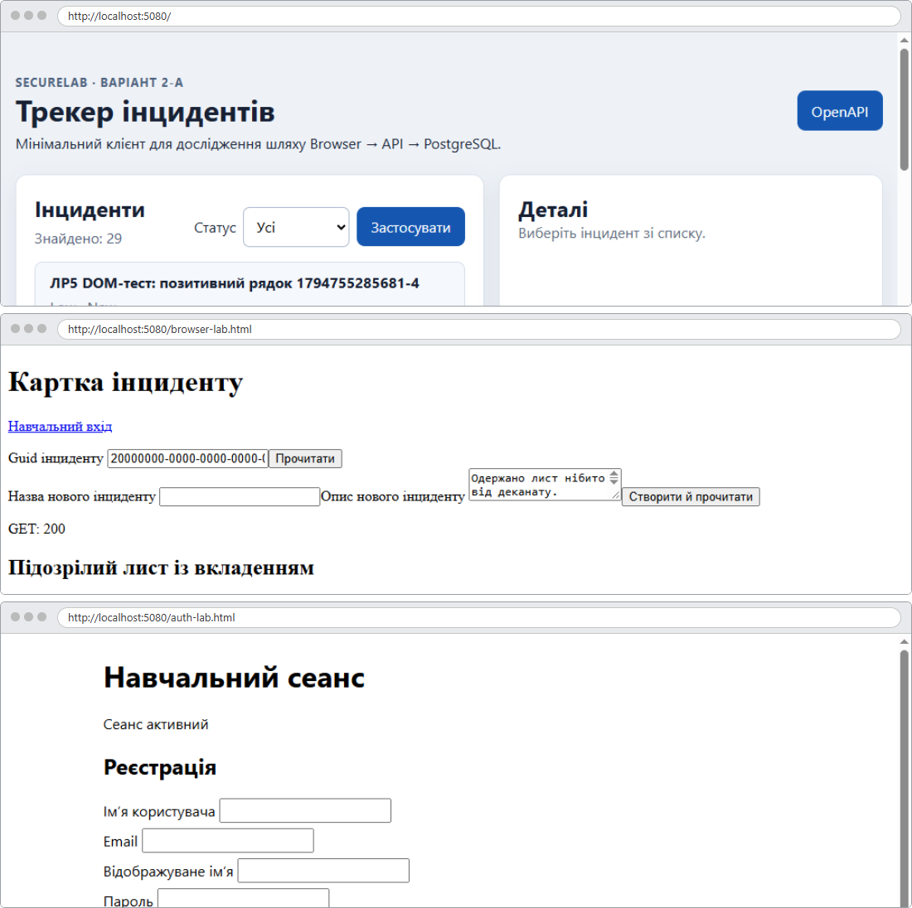

*Рис. 48. Три сторінки flow під enforcement CSP: список /, browser-lab.html, auth-lab.html.*

Важливий висновок із цього досліду: у тому ж Console я присвоїв marker через innerHTML тимчасовому елементу. У report-only marker виконався (executed), в enforcement елемент  усе одно створено (imgElements: 1), але marker не виконався, бо CSP заборонила inline handler. Тобто CSP тут лише прикрила небезпечний sink. Виправленням залишається safe DOM rendering, а висновок про виправлення я роблю тільки за DOM: текстовий вузол і немає .

Таблиця 12. Заголовки і policy rationale.

| Header / control | Значення | Ризик, який зменшує, і межа |
|---|---|---|
| X-Content-Type-Options | nosniff | MIME sniffing: браузер не вгадує тип за вмістом. Не замінює правильний Content-Type і валідацію |
| Referrer-Policy | no-referrer | зайве передавання адреси сторінки. Клієнту посилання назовні не потрібні, тому no-referrer підходить. Не дозволяє класти secrets в URL |
| CSP frame-ancestors | 'none' | вбудовування в чужий iframe і clickjacking. Не замінює authorization і не усуває XSS. Не має fallback до default-src, тому вказано явно |
| CSP script-src | 'self' | інжекцію inline-скриптів і чужих script. Лише додатковий шар після safe sink |

Усі три заголовки видно на фактичній відповіді основного клієнта (Рис. 46) і в тестах (розділ 12). X-Frame-Options я не додавав: frame-ancestors сучасніший, а суперечливі значення ускладнили б перевірку.

## 11. Контексти виведення, URL і сторонній код

Контрзахист залежить від того, як браузер має використати значення. Для текстового вузла достатньо textContent або createTextNode, бо HTML parser не викликається. У значення атрибута потрібен дозволений атрибут і перевірка його семантики: runtime-імена атрибутів, on* і srcdoc небезпечні, а setAttribute не є універсально безпечним. В URL (href, src) textContent не допоможе: небезпечна схема на кшталт javascript: працює, навіть якщо значення встановлено DOM API, тому URL розбирає new URL, дозволяються лише потрібні протоколи, а за потреби й hosts. У JavaScript-контексті код не будують зі string: eval, new Function і рядкові обробники заборонені, дані передаються як дані в наперед визначену функцію (таблиця 13).

Таблиця 13. Різні правила виведення для чотирьох контекстів.

| Контекст | Безпечний спосіб | Небезпечна підміна |
|---|---|---|
| Текстовий вузол | createElement, textContent, createTextNode | конкатенація в HTML-рядок для innerHTML |
| Значення атрибута | дозволений атрибут через властивість або setAttribute, перевірка значення | runtime-імена атрибутів, on*, srcdoc |
| URL | new URL, allowlist протоколів (https, http) і за потреби hosts, потім href/src | приймати javascript: лише тому, що значення поставлено DOM API |
| JavaScript / code | дані передавати як дані у відому функцію | eval, new Function, string handler, значення у script |

Для URL-контексту я запустив у Console нейтральний safe-url.js (tests/browser/safe-url.js). Рядок розбирає сам браузер, а не regular expression, тому регістр і пробіли на початку не обходять перевірку. Дозволені https://example.com/a і /incidents/1, а javascript:alert(1), " JaVaScRiPt:alert(1)" і зламаний URL дають null, тобто посилання не створюється. Створене посилання має лише href, атрибута onclick немає (Рис. 49). У застосунку посилань з даних немає, тому цей приклад лише показує правило, а новий sink я не додавав.

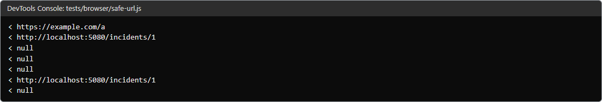

*Рис. 49. safe-url.js: два дозволені URL, три null, href посилання і відсутній onclick.*

Third-party scripts. У дослідженому клієнті сторонніх скриптів немає: усі <script src> ведуть на власні файли, а CSP script-src 'self' не дозволяє інших. Залишковий ризик дає довідник Scalar у Development: він формує UI зі сторонніх package і має власні джерела ресурсів, тому я виключив його з CSP і зафіксував це як межу. Окремий аудит залежностей належить до ЛР 6. Якби сторонній скрипт було підключено, він виконувався б з правами сторінки й міг би читати DOM, а CSP з allowlist лише обмежила б джерела.

## 12. Регресії і автоматизовані тести

REG-XSS-01 і REG-CORS-01 описані як повторювані процедури (таблиці 14 і 15). Окрім ручних кроків, є автоматичні перевірки: DOM-тест у браузері (Рис. 15, 27) і 18 нових C# тестів у tests/SecureLab.Api.Tests/BrowserSecurityTests.cs. Вони перевіряють точний Allow-Origin для 4173 і відсутність його для 4174, preflight з точними методом і заголовком, що схожі origins (null, чужий хост із префіксом, зі слешем, https) не відбиваються, що кожна відповідь має enforced CSP без unsafe-inline, unsafe-eval і *, nosniff і no-referrer, що в клієнтських скриптах немає innerHTML, outerHTML, insertAdjacentHTML, document.write і eval, а в сторінках немає inline-скриптів, стилів і обробників (Рис. 51).

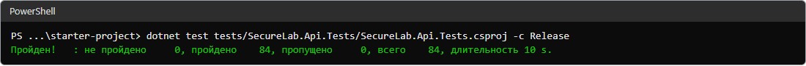

*Рис. 50. Усі тести проєкту на fixed commit: 84 з 84.*

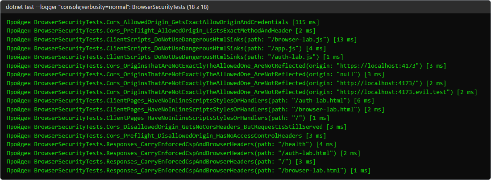

*Рис. 51. Нові тести BrowserSecurityTests: 18 з 18.*

Таблиця 14. REG-XSS-01.

| Поле | Вміст |
|---|---|
| Передумови | commit b77f2a3 (або vulnerable 0ea0de4 для негативного контролю), docker compose up -d --wait, SeedUsers__Password задано поза Git, dotnet run --project src/SecureLab.Api -- --reset-database, потім dotnet run --project src/SecureLab.Api; акаунти alice, morgan, bob; браузер на http://localhost:5080 |
| Вхід | канонічний marker з Lab_5/lab05-marker.txt, без зовнішніх hosts і без secrets |
| Кроки | 1) увійти як alice на /auth-lab.html; 2) на /browser-lab.html виконати команду перевірки (очікується null); 3) створити запис з marker в описі; 4) скопіювати Guid; 5) у приватному вікні увійти як morgan і прочитати цей Guid; 6) для коментаря відкрити як alice інцидент 20000000-0000-0000-0000-000000000001 з seed-коментарем …-0005; 7) запустити tests/browser/description-dom.js |
| Очікуваний результат | marker не виконується, команда перевірки повертає null в обох сеансах, DOM містить один текстовий вузол, нормальні рядки (апостроф, лапки, 5 < 7, Unicode, <b>, 4000 символів) відображаються як текст, у БД і JSON значення незмінне; DOM-тест RESULT: PASS |
| Негативний контроль | на vulnerable commit 0ea0de4 marker виконується (executed), DOM-тест RESULT: FAIL |
| Доказ | Network і Elements, файли browser-lab.js, description-dom.js; Рис. 9–27 |

Таблиця 15. REG-CORS-01.

| Частина | Вміст |
|---|---|
| Browser evidence | API у Development на 5080; probes py -3 -m http.server 4173 --bind localhost --directory demonstrations/cors-probe і те саме для 4174; на кожній сторінці виконати простий запит і запит із X-Lab-Cors-Probe до абсолютної адреси API. 4173 отримує response, 4174 ні; у Network запит до http://localhost:5080/health має Origin відповідної сторінки |
| HTTP evidence | curl.exe -sS -D - -o NUL -H "Origin: http://localhost:4173" "http://localhost:5080/health", потім те саме з Origin 4174. Для 4173 є Access-Control-Allow-Origin: http://localhost:4173 (і Allow-Credentials: true), для 4174 жодного Access-Control-*; в обох 200, nosniff і no-referrer |
| Перевірка порядку | з 4173 запит без cookie до /api/incidents дає 401, який JavaScript читає |
| Автоматично | BrowserSecurityTests (Cors_* тести) |

## 13. Review: XSS, CORS, CSRF і authorization

Ці чотири речі працюють на різних межах і одна одну не замінюють.

Таблиця 16. Розрізнення на власному flow.

| Механізм | Що робить у моєму flow | Чого не робить |
|---|---|---|
| XSS | недовірений текст стає кодом у браузері через innerHTML. Усунуто safe DOM rendering | не залежить від CORS чи авторизації: marker виконався в сеансі Morgan, хоча Morgan мав право читати запис |
| CORS | визначає, чи надасть браузер cross-origin response JavaScript (4173 так, 4174 ні) | не автентифікує, не перевіряє власника, не зупиняє curl і запит до API; не усуває XSS |
| CSRF | cookie надсилається браузером автоматично, тому state-changing запит може бути підроблений | CORS від цього не захищає: простий запит доходить до сервера, як видно за журналом API. Antiforgery виконується в ЛР 6, я його тут не вигадував |
| Authorization | сервер за principal, дією і ресурсом вирішує, чи можна читати чи змінювати (ЛР 4: Bob отримує 404) | не робить безпечним вивід: сервер правильно віддав значення, XSS виник у клієнті |

## 14. Тег і передавання коду

Тег v0.5.0 я поставив анотованим на fixed commit b77f2a3 тільки після того, як retest, DOM-тест, CORS, CSP і всі 84 тести пройшли на чистому дереві (Рис. 52). Історія гілки показує окремі коміти для vulnerable і fixed станів (Рис. 53), а diff між ними містить виправлення, CORS, CSP і тести (Рис. 54).

*Рис. 52. Анотований тег v0.5.0 на fixed commit.*

*Рис. 53. Історія гілки lab/5-browser-xss: scaffold, vulnerable, seed і DOM-тест, safe rendering, fixed.*

*Рис. 54. Зміни між vulnerable і fixed commit.*

Таблиця 17. Підсумок Git-артефактів.

| Артефакт | Значення |
|---|---|
| Release scaffold | lab-05-start-v1 (base_commit 7ce14f164eeb8f4b5eaa9299596c19ecbf884118, entry_parent 1611825d420aab6b93f846c9f28428ea385916ba) |
| Vulnerable commit | 0ea0de49118159c46908bb7de95389cc0bbb18a2 |
| Fixed commit | b77f2a3df8b77bda21c1a5ef8bc68a54bdb9faaf |
| Тег | v0.5.0 (анотований) на fixed commit |
| Гілка | lab/5-browser-xss |
| main | після fast-forward містить fixed commit; поверх нього лише коміт із документами й звітом |
| Remote | https://github.com/AndriiShuplik/Lab1_Shuplik |

## 15. Відповіді на контрольні питання

**1. Чому value з БД може залишатися недовіреним?** Запис у PostgreSQL не змінює походження значення. Текст, який колись ввів користувач, лишається текстом користувача: при читанні він знову може потрапити в небезпечний sink. У моєму потоці marker лежить у БД без змін, а небезпечним він стає лише під час виведення через innerHTML.

**2. Що таке source, transformation і sink у вашому flow?** Source це поле description у формі (і seed-коментар). Transformations: JSON у POST, DTO і Trim() на сервері, колонка в БД, JSON у GET, current = await response.json(). Жодне з них не очищає HTML. Sink це #description.innerHTML і paragraph.innerHTML у load(), контекст HTML parser.

**3. Чим stored XSS відрізняється від reflected та DOM-based XSS?** Stored: значення спершу зберігається і виконується під час пізнішого перегляду. Reflected: значення поточного запиту одразу повертається у відповідь без зберігання. DOM-based: JavaScript клієнта бере значення з джерела (URL, storage, response) і сам передає у небезпечний DOM sink. Ознаки перетинаються: мій потік stored і водночас DOM-based за місцем перетворення.

**4. Чому блокування <script> не усуває XSS?** Елемент <script>, вставлений через innerHTML, браузер не виконує, а marker працює через . Обробники подій, інші елементи і URL-схеми теж виконують код. Фільтр одного слова не змінює того, що parser отримує недовірений HTML.

**5. Коли обирають textContent, а коли потрібен sanitizer?** Для звичайного тексту достатньо textContent або createTextNode: sanitizer лише збільшує поверхню атаки. Sanitizer потрібен тоді, коли продукт явно дозволяє обмежений HTML, і треба allowlist елементів, атрибутів і протоколів. У моїй роботі formatted HTML не дозволено, тому sanitizer я не додавав.

**6. Чому sanitizer не пишуть regular expression?** Regular expression не відтворює правил HTML parser і різних контекстів, тому такий фільтр обходять. Потрібна підтримувана бібліотека з тестами (наприклад DOMPurify) і мінімальним allowlist.

**7. З яких трьох компонентів складається origin?** Зі схеми, host і порту. Шлях, query і fragment не входять. Тому localhost:5080, localhost:4173 і localhost:4174 це різні origins.

**8. Що browser надсилає в CORS preflight і хто його ініціює?** Preflight ініціює сам браузер, код сторінки його не пише. Це OPTIONS до того ж URL з Origin, Access-Control-Request-Method (мій GET) і Access-Control-Request-Headers (x-lab-cors-probe). У Network я бачив його перед actual GET.

**9. Хто оголошує CORS-політику і хто її застосовує?** Оголошує сервер: API повертає Access-Control-Allow-* заголовки (policy Lab05BrowserProbe). Застосовує браузер: він вирішує, чи надати response JavaScript. API відповідає на запит, а заборона читання це робота браузера.

**10. Чому curl може прочитати API response, коли browser script отримує CORS error?** Same-origin policy і CORS це правила браузера для веб-контенту. curl їх не застосовує, тому читає відповідь, а API все одно виконує authentication і authorization. Статус 200 на /health для Origin 4174 це підтвердив.

**11. Чому CORS не є authorization і не замінює CSRF-захист?** CORS не перевіряє, хто користувач і чи має він право на ресурс. Простий cross-origin запит може дійти до сервера і змінити стан, навіть якщо браузер не покаже відповідь (запит із 4174 виконано, за журналом API). Захист від CSRF потребує окремого antiforgery-механізму (ЛР 6).

**12. Чому wildcard origin не поєднують із credentials?** Для відповіді з credentials браузер вимагає конкретний origin і Allow-Credentials: true, а * для такої відповіді недійсне. ASP.NET Core відхиляє таку policy ще на старті. Відбиття довільного Origin так само небезпечне, бо фактично дозволяє всім.

**13. Яку межу має CSP і чому вона не замінює safe DOM rendering?** CSP обмежує джерела ресурсів і деякі способи виконання коду. У моєму досліді вона заблокувала inline handler, але елемент  із небезпечного sink усе одно з'явився. Основне виправлення XSS це не передавати недовірені дані в інтерпретований контекст.

**14. Який risk зменшують nosniff, Referrer-Policy і frame-ancestors?** nosniff забороняє MIME sniffing. Referrer-Policy no-referrer прибирає передавання адреси сторінки. frame-ancestors 'none' забороняє вбудовування в чужий iframe і зменшує clickjacking. Жоден із них не замінює правильний Content-Type, секрети поза URL чи authorization.

## 16. Обмеження і висновок

- Усі перевірки зроблено локально на навчальному стенді зі штучними даними; зовнішніх сайтів я не перевіряв.
- Marker використано тільки з lab05-marker.txt: він змінює лише атрибут на #lab05-marker-target, нічого не читає і нікуди не надсилає.
- Браузер: Chrome 157. Знімки сторінок зроблено в Chrome, а панелі Network, Elements і Console на рисунках відтворено з даних, які я записав у Chrome через DevTools Protocol (запити, заголовки, DOM, повідомлення Console). Живі вікна DevTools не знімались.
- Повний CSRF-захист (antiforgery), rate limit і аудит залежностей до ЛР 5 не входять, це ЛР 6.
- Policy Lab05BrowserProbe навчальна: лише Development, у Production її немає.
- Scalar у Development виключено з CSP; його сторонні ресурси я не аналізував.
- Sanitizer, upload і rich-text editor не додавав: за умовою завдання HTML у полях не дозволено.

У цій роботі я перейшов від «сервер правильно віддає дані» до питання, як браузер ці дані інтерпретує. На vulnerable коді marker, який записала Alice, виконався в сеансі Morgan, хоча авторизація працювала правильно. Причина була в двох innerHTML у load(). Я замінив їх одним helper із текстовим вузлом, не змінюючи значення в БД, і той самий marker перестав виконуватися, а звичайні рядки з лапками, < і >, Unicode і 4000 символів відображаються правильно. Окремо я показав, що CORS керує лише читанням response у браузері, а API при цьому все одно виконує запит (curl і журнал API), що CSP заблокувала inline handler, але не прибрала небезпечний sink, і що nosniff, Referrer-Policy та frame-ancestors закривають інші ризики. Усі 84 тести проходять, тег v0.5.0 стоїть на перевіреному fixed commit.
