# Звіт про виконання лабораторної роботи № 3

**Автентифікація та безпечна робота з обліковими даними**

Дисципліна: «Прикладні технології програмування в інформаційній безпеці». Змістовий модуль 1: «Від архітектури вебсистеми до перевіреного контексту користувача».

Виконав: Шуплик Андрій Олександрович, група КБ-41.

Обраний рівень: відмінний («Відмінно»). Baseline 2-A, підсумковий тег v0.3.0.

## 1. Відтворення

| **Параметр** | **Значення** |
|---|---|
| Обраний рівень | Відмінний («Відмінно»): усі вимоги доброго рівня та два поглиблення — відкликання сеансу після зміни security stamp (розділ 3.10) і threat analysis login flow (розділ 3.13) |
| Baseline | 2-A (спільний, індивідуальних варіантів немає) |
| Base tag | v0.2.0 (Рис. 2) |
| Scaffold | lab-03-start-v1; base_commit і entry_parent: 3ae76b4d92a0f537470cbe7ceec7dfa45ad9c4f1 (файл .scaffolds/lab-03.json) |
| Commit встановлення scaffold | e4a2ca4 «Install scaffold lab-03-start-v1» (Рис. 6) |
| Гілка | lab/3-authentication |
| Перевірений commit і тег | підсумковий commit із тегом v0.3.0 вказано в артефакті DEL-03; на момент останнього прогону тестів HEAD — f408f30 |
| ОС і SDK | Windows, .NET SDK 10.0.402 (Рис. 2); редактор — Visual Studio, PostgreSQL у Docker Compose |
| Команди | docker compose --env-file infra/.env.example -f infra/compose.yaml up -d --wait; dotnet run --project src/SecureLab.Api -- --reset-database (двічі); dotnet build та dotnet test для tests/SecureLab.Api.Tests у конфігурації Release |
| Результат | після встановлення scaffold — 29 тестів без збоїв (Рис. 11); після завершення роботи — 42 тести без збоїв (Рис. 45) |
| Migration і reset | міграція Lab03Identity застосовується при запуску (Рис. 8); два послідовні reset завершуються з кодом виходу 0 (Рис. 11), тести проходять (Рис. 9, 45) |

Спочатку я розпакував архів scaffold поза проєктом (Рис. 1), перевірив вхідний стан гілки та SDK (Рис. 2), виконав пробний запуск installer (Рис. 3) і лише після перегляду змін встановив scaffold (Рис. 4). Змінені та нові файли переглянув (Рис. 5) і зберіг окремим commit (Рис. 6). Після цього перевірив збірку (Рис. 7), застосував міграцію та seed командою --reset-database (Рис. 8), запустив тести (Рис. 9, 10) і переконався у повторюваності двома послідовними reset (Рис. 11).

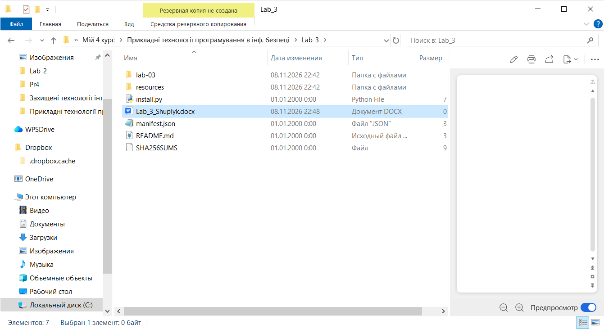

Рис. 1. Розпакований архів scaffold lab-03-start-v1 у каталозі Lab_3 поза проєктом SecureLab.

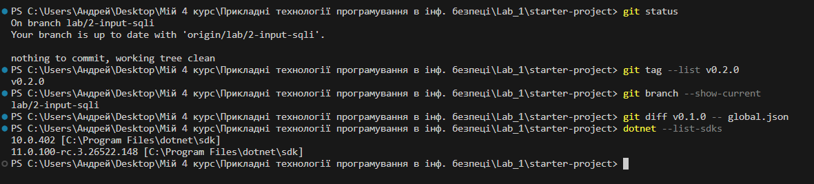

Рис. 2. Вхідний стан перед ЛР 3: чисте робоче дерево, тег v0.2.0, гілка lab/2-input-sqli, встановлена .NET 10 SDK.

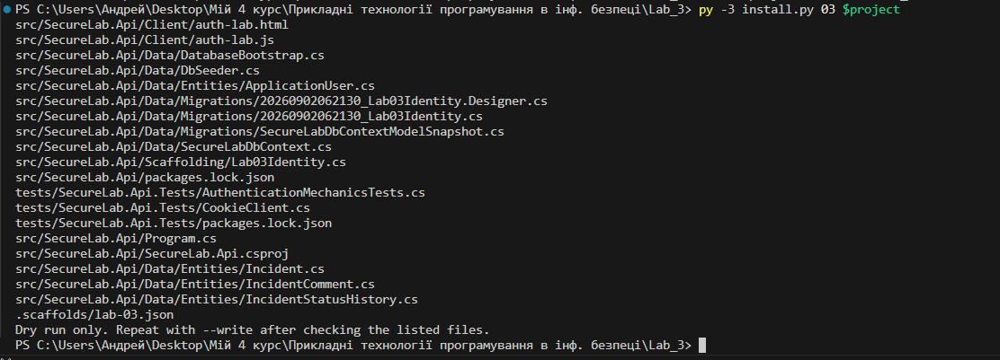

Рис. 3. Пробний запуск installer scaffold lab-03-start-v1 (dry run): перелік файлів, які буде записано, без змін у проєкті.

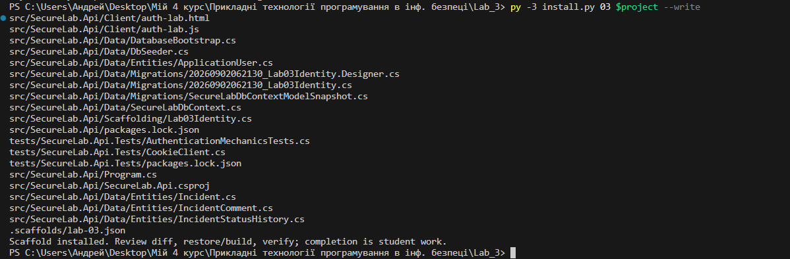

Рис. 4. Встановлення scaffold lab-03-start-v1 поверх v0.2.0: installer завершився повідомленням Scaffold installed.

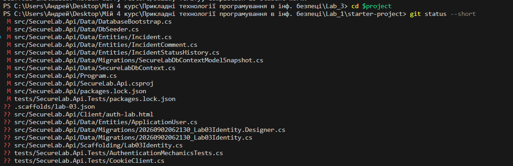

Рис. 5. Стан робочого дерева після встановлення scaffold: змінені та нові файли, додані installer.

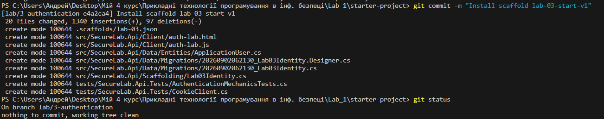

Рис. 6. Окремий commit scaffold lab-03-start-v1 у гілці lab/3-authentication.

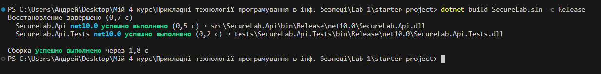

Рис. 7. Успішна збірка проєкту SecureLab після встановлення scaffold (Release).

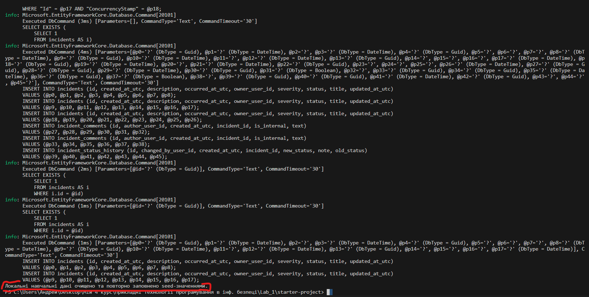

Рис. 8. Виконання dotnet run --project src/SecureLab.Api -- --reset-database у гілці lab/3-authentication: міграцію Lab03Identity застосовано, початкові дані повторно засіяно.

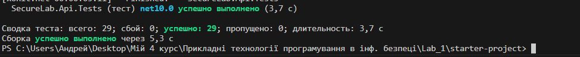

Рис. 9. Результат запуску тестів після встановлення scaffold: усі тести пройдені, включно з RealCookie_ReachesSessionCheck.

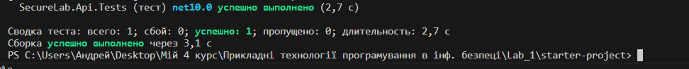

Рис. 10. Механічний тест RealCookie_ReachesSessionCheck: login Alice за паролем із SeedUsers\_\_Password і доступ до /api/auth/session-check (204) пройшли успішно.

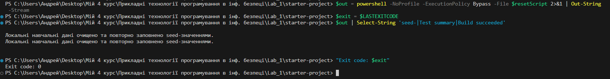

Рис. 11. Перевірка повторюваності: два послідовні --reset-database завершилися з кодом виходу 0, база повертається до того самого стану; тести після скидання проходять (29 без збоїв, Рис. 9).

## 2. Власна реалізація і межі

### 2.1. Початковий стан досліджуваних місць

Після встановлення scaffold форма входу працює (Рис. 12), а GET /api/me повертає заглушку 501 (Рис. 13). У коді scaffold також є два навмисні недоліки, які ця робота усуває: /api/me довіряє заголовку X-Demo-UserId, а створення інциденту доступне без входу й бере власника зі сталого контексту ЛР 2.

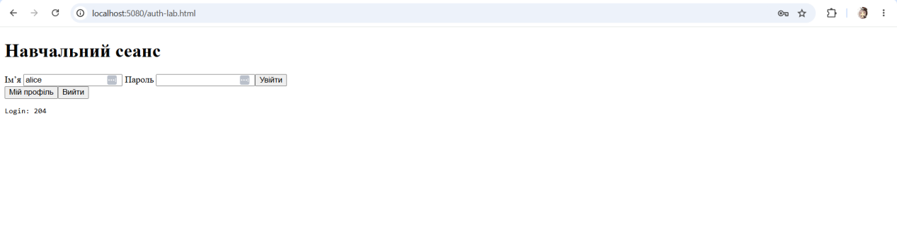

Рис. 12. Початковий стан auth-lab.html: вхід Alice дає Login: 204.

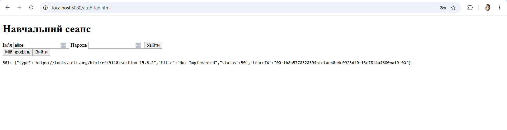

Рис. 13. Початковий стан GET /api/me: заглушка повертає 501 Not Implemented.

### 2.2. Підсумок реалізації

- **DTO boundary.** Реєстрація приймає лише RegisterRequest (userName, email, displayName, password) і повертає RegisterResponse (id, userName, displayName). Id генерує сервер, роль Reporter призначається на сервері. Password, PasswordHash, security stamp і роль у контракт не входять.

- **Звідки беруться id.** GET /api/me читає ідентифікатор із HttpContext.User, а POST /api/incidents записує у Incident.OwnerUserId id поточного principal. Поле ownerUserId у тілі запиту ігнорується, заголовок X-Demo-UserId не читається.

- **Cookie options.** HttpOnly = true, SameSite = Lax, Secure = SameAsRequest у Development і Always у production-профілі. Локальний HTTP-запуск не доводить наявності Secure: на Рис. 18 цього прапорця немає, тому наявність Secure перевірено окремим тестом через HTTPS.

- **Фактичні flags (добрий).** Тест Login_OverHttps_SetsExpectedCookieFlags виконує login через HTTPS-адресу тестового клієнта й перевіряє атрибути Set-Cookie без друку значення cookie (Рис. 28).

- **Строк дії.** Стандартний для Identity: cookie сеансова, без Expires, із ковзним продовженням; значення не змінював. Закриття вікна браузера не замінює logout, а відновлення сеансу браузером може зберегти cookie.

- **Login-відмови.** Невідомий користувач і хибний пароль дають однаковий 401 без тіла з деталями; автоматизовано сценарієм A-07.

- **Duplicate-контракт (добрий).** Некоректне тіло дає 400 (ValidationProblem), повторна реєстрація існуючого імені або email — 409 Conflict з нейтральним problem+json «Registration conflict». Регресія — тест Register_Duplicates_Return409.

- **Обмеження входів і події (добрий).** Ключ partition — адреса клієнта. Ліміт — 20 запитів до login за хвилину з однієї адреси; запит понад ліміт отримує 429, а доступ відновлюється після завершення вікна. У подію автентифікації входять лише тип події, результат (success, failure, rate_limited) і trace-ідентифікатор; ім’я користувача є тільки в події успіху. Пароль, hash, cookie і токени до журналу не потрапляють (Рис. 31, 32).

- **CSRF.** SameSite=Lax відсікає частину міжсайтових запитів, але не є повним CSRF-захистом. Це навчальний борг до ЛР 6, який я не вважаю закритим.

- **Поглиблення (відмінний).** Виконано два: перевірка відкликання сеансу після зміни security stamp (розділ 3.10) і стислий threat analysis login flow (розділ 3.13).

## 3. Докази

### 3.1. Реєстрація, T-01 і T-02 (CP-01)

Endpoint POST /api/auth/register спочатку виконує валідацію DTO, потім створює користувача через UserManager.CreateAsync (hash пароля обчислює Identity), призначає роль і повертає безпечну відповідь 201 (Рис. 14). Контракт запиту й відповіді показано на Рис. 15. Ручна перевірка: новий користувач — 201 без пароля й hash, повторна реєстрація — 409 (Рис. 16). Пароль у скрипті не друкується.

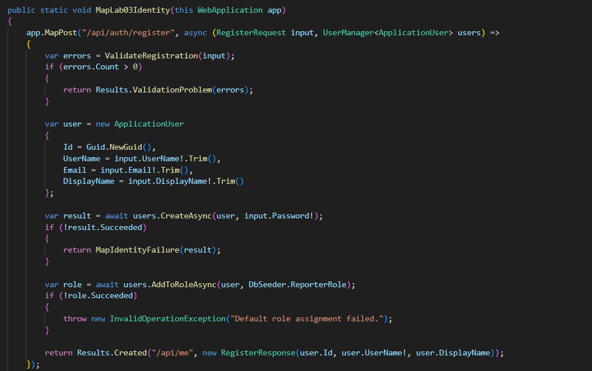

Рис. 14. Endpoint POST /api/auth/register: валідація вхідного DTO, створення користувача через UserManager.CreateAsync (hash обчислює Identity) і безпечна відповідь 201 без чутливих полів.

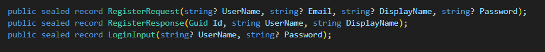

Рис. 15. Request DTO (лише userName, email, displayName, password) і response DTO (id, userName, displayName): серверні поля, hash і security stamp у контракт не входять.

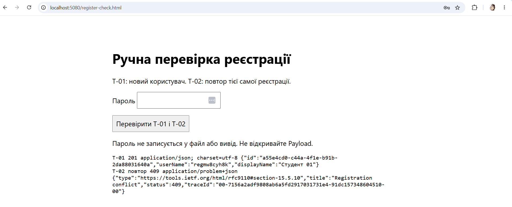

Рис. 16. Ручний доказ T-01 (201 Created, відповідь без пароля й hash) та T-02 (повторна реєстрація: 409 Conflict).

### 3.2. Cookie автентифікації

Успішний login повертає 204 і Set-Cookie з path=/; samesite=lax; httponly (Рис. 17). Через локальний HTTP атрибута secure немає, у Application → Cookies прапорець Secure порожній, а термін — Session (Рис. 18). Значення cookie на скріншотах приховано.

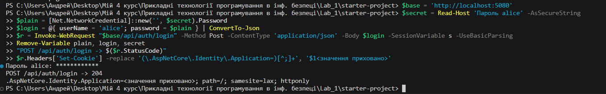

Рис. 17. Відповідь POST /api/auth/login: 204 No Content і Set-Cookie з атрибутами path=/; samesite=lax; httponly (значення cookie приховано).

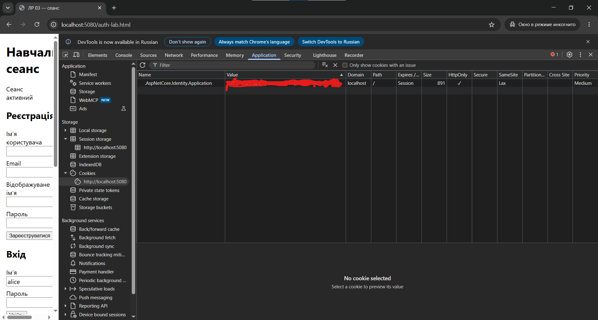

Рис. 18. Cookie .AspNetCore.Identity.Application у DevTools: HttpOnly, SameSite=Lax, термін Session, прапорця Secure немає, бо запит ішов через локальний HTTP (значення cookie приховано).

### 3.3. Збереження пароля, T-03

У таблиці identity_users немає стовпця для відкритого пароля: пароль представлено лише полем PasswordHash типу text (Рис. 19). Опис таблиці отримано без вибірки даних.

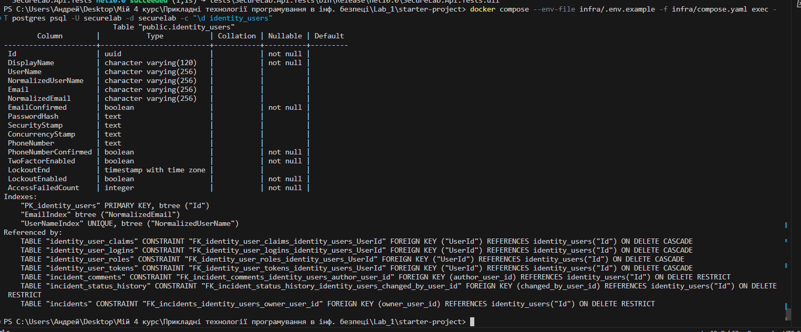

Рис. 19. Структура таблиці identity_users (T-03): пароль зберігається лише як PasswordHash типу text, стовпця для відкритого пароля немає.

### 3.4. Вхід і GET /api/me, A-01, A-02, A-03 (CP-02)

Анонімний запит до /api/me повертає 401 без перенаправлення на HTML-сторінку (Рис. 20). Після входу Alice endpoint повертає профіль поточного користувача лише з дозволеними полями (Рис. 21). Запит із заголовком X-Demo-UserId Bob без cookie також дає 401, тобто заявлений клієнтом ідентифікатор не є доказом особи (Рис. 22). Реалізація бере id з HttpContext.User (Рис. 23); сценарій A-03 для дійсної cookie автоматизовано тестом A03_ForeignDemoHeader\_… (Рис. 28).

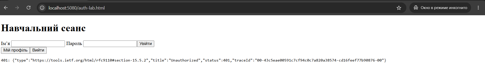

Рис. 20. GET /api/me без автентифікації (A-01): 401 Unauthorized, перенаправлення на сторінку входу немає.

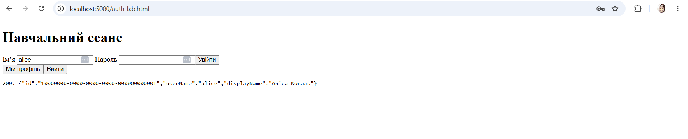

Рис. 21. Login Alice → GET /api/me (A-02): 200 OK, профіль поточного користувача з principal, лише дозволені поля.

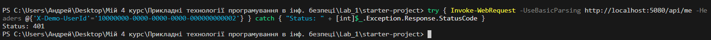

Рис. 22. GET /api/me із заголовком X-Demo-UserId Bob без cookie: 401 Unauthorized, клієнтський ідентифікатор не є доказом особи.

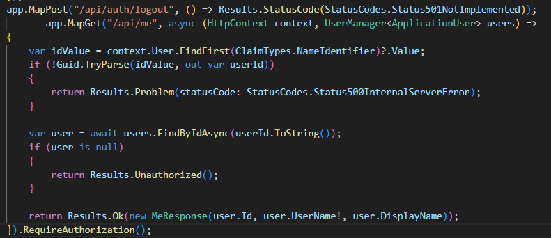

Рис. 23. Реалізація GET /api/me: ідентифікатор береться з HttpContext.User, endpoint вимагає автентифікації (CP-02).

### 3.5. Вихід, A-06

POST /api/auth/logout повертає 204 і Set-Cookie, який наказує браузеру видалити cookie (Рис. 24). Повторний GET /api/me після виходу дає 401 (Рис. 25).

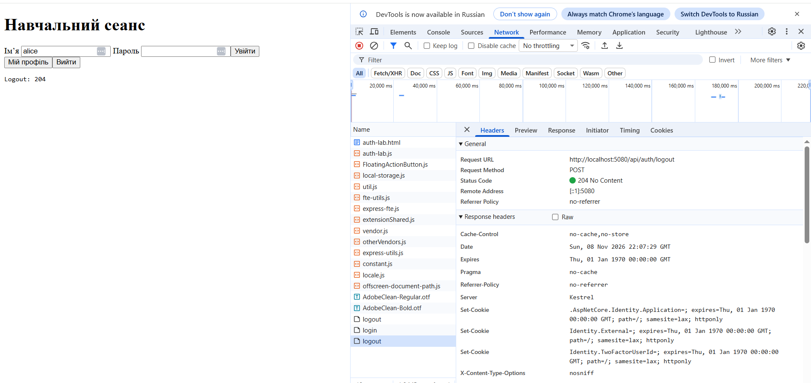

Рис. 24. Відповідь POST /api/auth/logout: 204 No Content і Set-Cookie, який наказує браузеру видалити cookie .AspNetCore.Identity.Application.

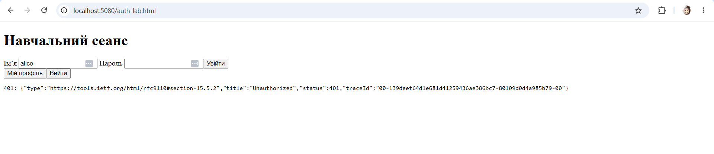

Рис. 25. Повторний GET /api/me після logout: 401 Unauthorized (цей сеанс завершено).

### 3.6. Захищене створення інциденту, A-04 і A-05 (CP-03)

Анонімний POST /api/incidents повертає 401, код endpoint не виконується (Рис. 26). Для A-05 користувач bob надсилає запит із підробленим ownerUserId Alice: сервер створює запис, а власником нового інциденту є Боб Мельник (Рис. 27). Сценарій створення без власника в DTO автоматизовано тестом A04_CreateWithoutOwner\_… (Рис. 28).

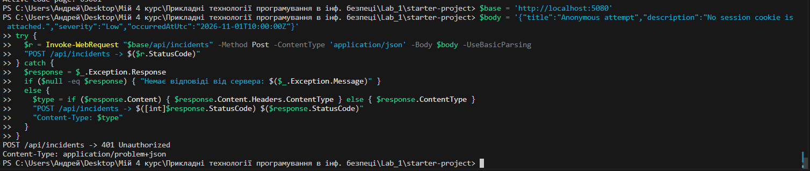

Рис. 26. Анонімний POST /api/incidents: 401 Unauthorized, код endpoint не виконано.

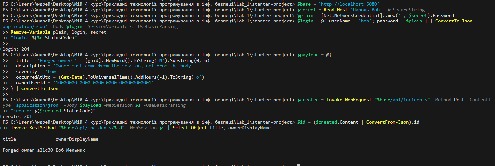

Рис. 27. POST /api/incidents від користувача bob із підробленим ownerUserId Alice: 201 Created, власник нового запису — Боб Мельник (A-05).

### 3.7. Автоматизовані тести

Клас AuthSecurityTests містить сценарії A-01…A-07, перевірку cookie flags через HTTPS та регресію duplicate-реєстрації; усі проходять (Рис. 28). Після переведення тестів створення на автентифікований клієнт повний набір також проходить (Рис. 29).

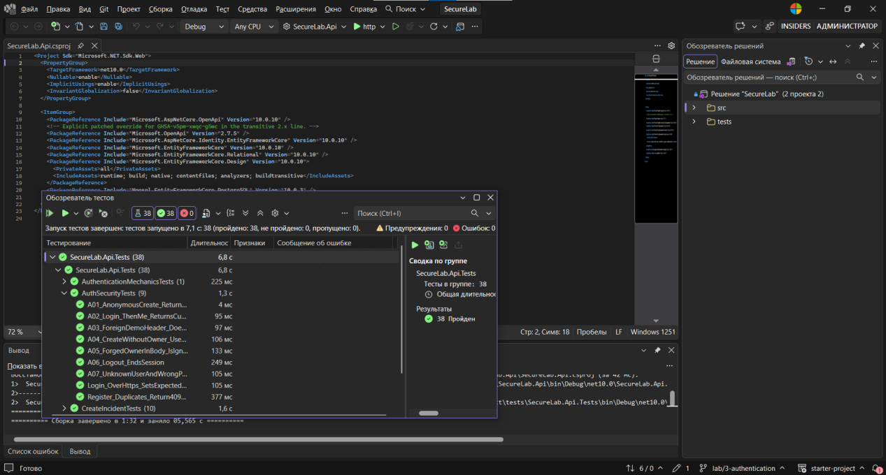

Рис. 28. Автоматизовані сценарії автентифікації A-01…A-07, перевірка duplicate-реєстрації та атрибутів cookie: усі тести пройдено (38 тестів).

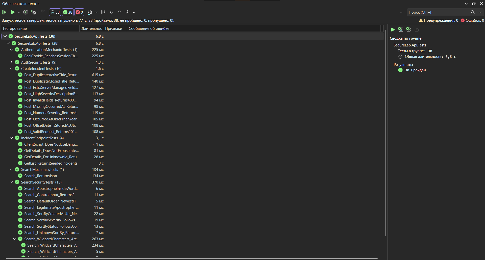

Рис. 29. Повний набір тестів після переведення створення на автентифікований клієнт і додавання сценаріїв безпеки: усі тести пройдено.

### 3.8. Обмеження входів і події автентифікації

У серії з 24 невдалих спроб з однієї адреси перші 20 повертають 401, а з 21-ї — 429 (Рис. 30). У журналі застосунку фіксуються події success, failure і rate_limited без credentials (Рис. 31, 32). Рядки SQL у журналі EF Core містять лише імена стовпців і параметр @normalizedUserName без значення. Поведінку обмеження також перевіряють три автоматичні тести: 429 після ліміту незалежно від імені користувача, відновлення після вікна та незалежний лічильник окремого хоста (Рис. 32б).

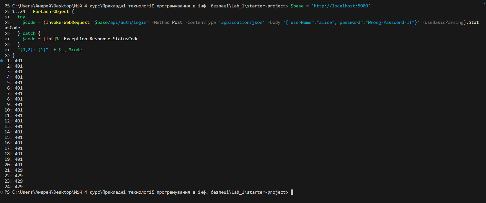

Рис. 30. Обмеження спроб входу: перші 20 запитів за хвилину з однієї адреси дають 401, починаючи з 21-го сервер повертає 429 Too Many Requests.

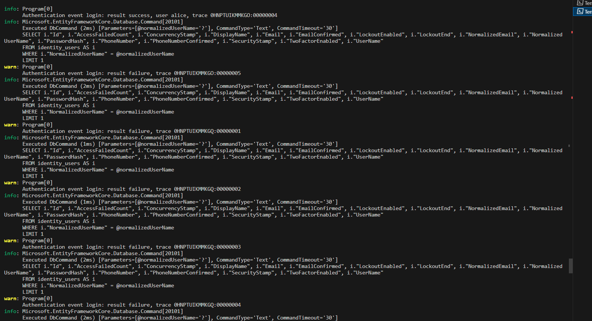

Рис. 31. Події автентифікації в журналі застосунку: успіх, невдачі та перевищення ліміту без credentials (початок фрагмента).

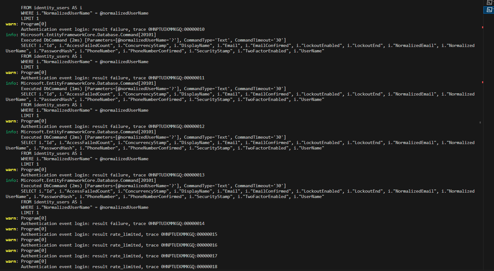

Рис. 32. Події автентифікації в журналі застосунку: невдалі спроби та події rate_limited без credentials (продовження фрагмента).

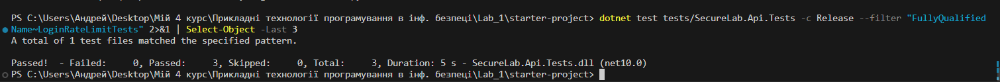

Рис. 32б. Тести rate limit для login: 429 після ліміту незалежно від імені користувача, відновлення після вікна, незалежний лічильник окремого хоста (3 тести пройдено).

### 3.9. Браузерний сценарій

Сценарій «реєстрація → вхід → профіль → створення → вихід» виконано в браузері. Спостереження 1: до входу стан анонімний (Рис. 33). Реєстрація через форму повертає 201 і не виконує автоматичний вхід (Рис. 34). Спостереження 2: після login видно лише дозволені поля профілю (Рис. 35). Спостереження 3: створення інциденту з форми — 201 (Рис. 36), у тілі запиту немає поля власника (Рис. 37). Спостереження 4: після logout профіль прибрано, повторний GET /api/me дає 401 (Рис. 38). Спостереження 5: Local storage і Session storage порожні, облікових даних у Console немає (Рис. 39, 40).

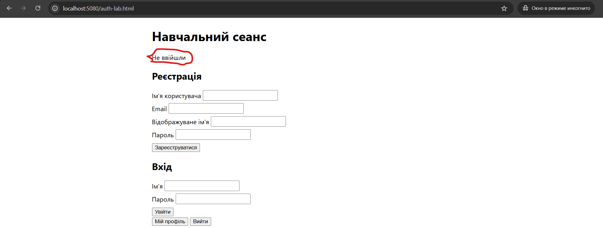

Рис. 33. Браузерний сценарій, спостереження 1: до входу стан анонімний, профіль не показується.

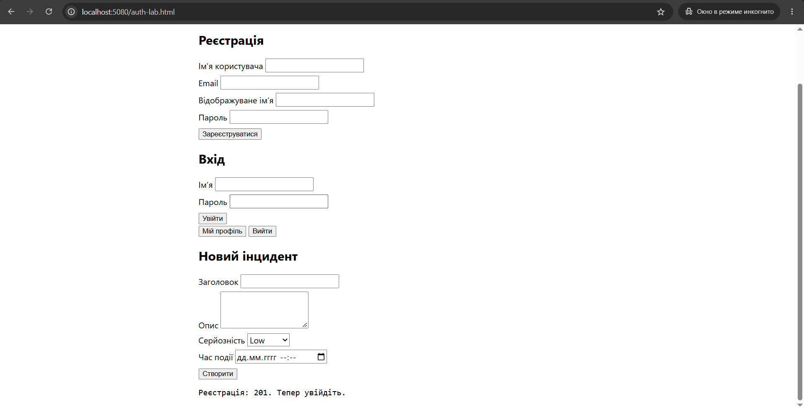

Рис. 34. Реєстрація через форму: 201 Created, автоматичного входу немає.

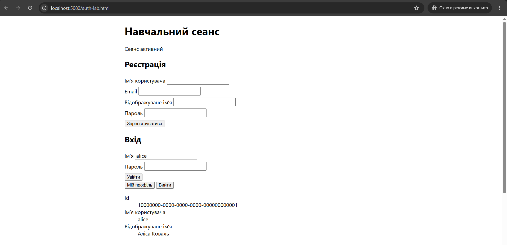

Рис. 35. Спостереження 2: після login Alice сеанс активний, показано лише дозволені поля профілю.

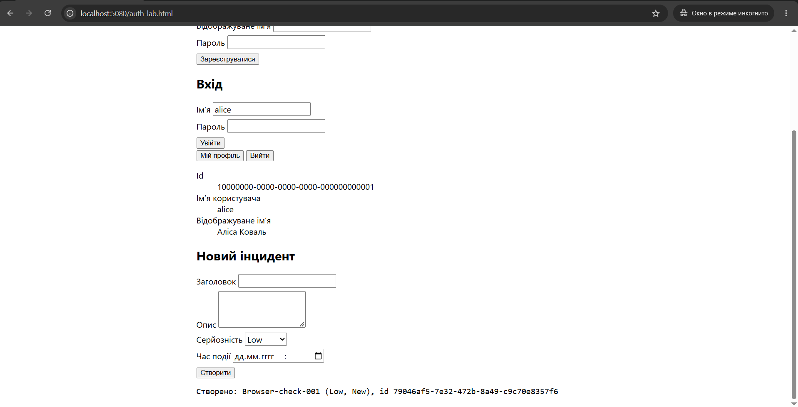

Рис. 36. Спостереження 3: створення інциденту з форми дає 201 Created.

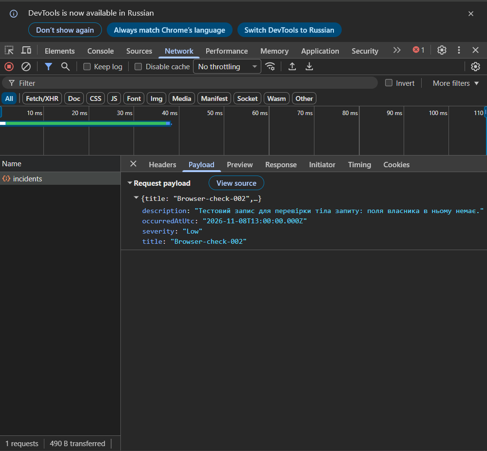

Рис. 37. Тіло запиту POST /api/incidents: лише title, description, severity і occurredAtUtc, поле власника відсутнє, власника визначає сервер.

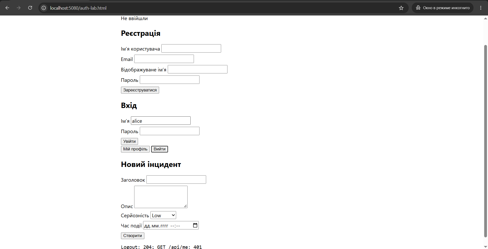

Рис. 38. Спостереження 4: після logout профіль прибрано, повторний GET /api/me тим самим браузером дає 401 Unauthorized.

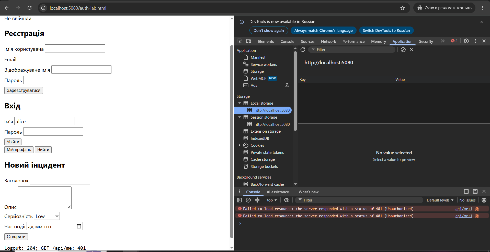

Рис. 39. Local storage для localhost:5080 порожній: облікові дані й профіль у сховищі не зберігаються (спостереження 5).

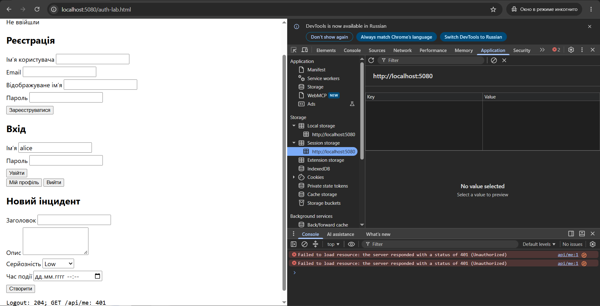

Рис. 40. Session storage для localhost:5080 порожній, у Console немає облікових даних (спостереження 5).

### 3.10. Повний набір тестів і поглиблення

Повний набір після reset: 41 тест без збоїв (Рис. 41). Поглиблення — відкликання сеансу: тест змінює security stamp користувача через UserManager.UpdateSecurityStampAsync, задає SecurityStampValidatorOptions.ValidationInterval = 0, щоб перевірка відбулася одразу, після чого раніше видана cookie дає 401, а новий вхід відновлює доступ (Рис. 42, 43). Із цим тестом набір налічує 42 тести.

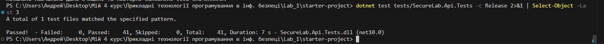

Рис. 41. Підсумок повного набору тестів після --reset-database: 41 тест пройдено, збоїв 0.

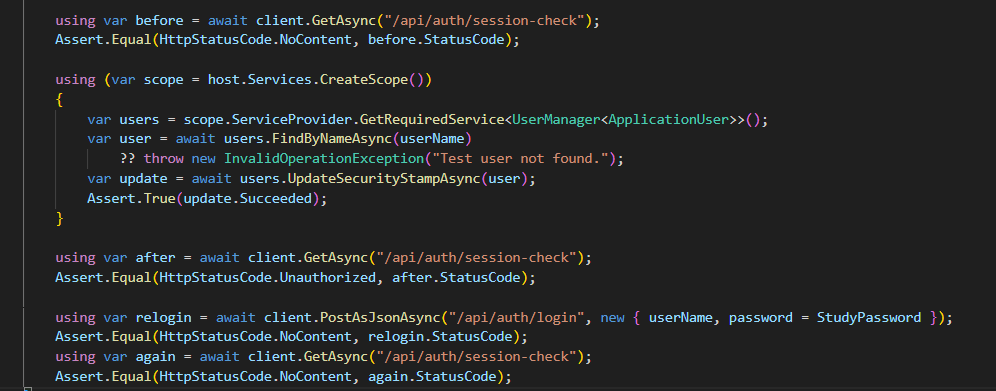

Рис. 42. Поглиблення: інтеграційний тест відкликання сеансу — після зміни security stamp раніше видана cookie дає 401, новий вхід працює.

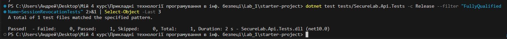

Рис. 43. Результат тесту SessionRevocationTests: сеанс після зміни security stamp відкликано (1 тест пройдено).

### 3.11. Перевірка витоку, S-01

У відстежуваних Git-файлах немає значення SeedUsers\_\_Password, а також файлів .env, .runsettings і .user (Рис. 44). Пароль для тестів задається змінною середовища поза Git. Підсумковий прогін після --reset-database — 42 тести без збоїв (Рис. 45).

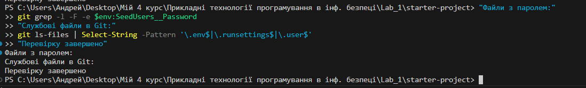

Рис. 44. Перевірка витоку (S-01): у відстежуваних Git-файлах немає навчального пароля, .env, .runsettings і файлів налаштувань IDE.

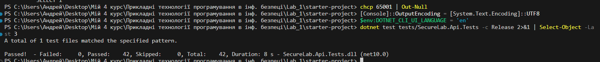

Рис. 45. Підсумковий прогін після --reset-database: 42 тести пройдено, збоїв 0 (повторюваність підтверджено, поглиблення включено).

### 3.12. Зведена таблиця доказів

| **ID** | **Сценарій** | **Очікувано** | **Фактично** | **Доказ** |
|---|---|---|---|---|
| T-01 | register з коректним DTO | безпечний 201 | 201 Created, тіло {id, userName, displayName} | Рис. 14–16 |
| T-02 | повторна реєстрація | безпечна відмова | 409 Conflict, application/problem+json «Registration conflict» | Рис. 16 |
| T-03 | опис identity_users | пароль не збережено відкрито | лише PasswordHash (text), стовпця відкритого пароля немає | Рис. 19 |
| A-01 | анонімний запит до /api/me | 401, без redirect | 401 Unauthorized | Рис. 20, 28 |
| A-02 | login → /api/me | поточний користувач із principal | 200 OK, лише дозволені поля | Рис. 21, 28 |
| A-03 | X-Demo-UserId іншого користувача | principal не змінюється | без cookie — 401; автотест із дійсною cookie пройдено | Рис. 22, 28 |
| A-04 | create без owner у DTO | owner = principal | автотест пройдено; у тілі запиту поля власника немає | Рис. 28, 37 |
| A-05 | Bob + forged owner Alice | owner = Bob | 201, власник нового запису — Боб Мельник | Рис. 27, 28 |
| A-06 | logout → захищений запит | 401 | cookie видалено, GET /api/me — 401 | Рис. 24, 25, 28 |
| A-07 | невідомий користувач і хибний пароль | однаковий зовнішній результат | однаковий 401; автотест пройдено | Рис. 28, 30 |
| S-01 | перевірка витоку | без витоків | пароля, .env, .runsettings у Git немає | Рис. 44 |
| Duplicate | повторна реєстрація, регресія | послідовні 400/409 | 409 для duplicate; тест Register_Duplicates_Return409 | Рис. 16, 28 |
| Cookie flags | login через HTTPS у тесті | контракт фіксованого профілю | тест Login_OverHttps_SetsExpectedCookieFlags пройдено; на HTTP Secure немає | Рис. 17, 18, 28 |
| Rate limit і події | 24 невдалі спроби входу | 429 після ліміту, події без credentials | 401 ×20, потім 429; події success/failure/rate_limited без credentials | Рис. 30–32 |
| Browser flow | п’ять спостережень етапу 4 | state / profile / create / logout | усі п’ять спостережень виконано | Рис. 33–40 |
| Поглиблення | відкликання сеансу | після зміни stamp cookie недійсна | 401 для старої cookie, новий login працює | Рис. 42, 43 |
| Поглиблення 2 | threat analysis login flow | активи, entry points, trust boundaries, загрози, контрзаходи, залишковий ризик | шість загроз із контрзаходами та залишковими ризиками наведено в розділі 3.13 | розділ 3.13 |

### 3.13. Поглиблення 2: threat analysis login flow

**Мета.** Стисло розібрати загрози для потоку «реєстрація → вхід → cookie → захищені операції», використовуючи лише реалізоване в цій роботі й докази зі звіту.

**Активи.** Пароль користувача та його PasswordHash у таблиці identity_users; сеансова cookie .AspNetCore.Identity.Application; ідентифікатор власника інциденту (OwnerUserId); журнал подій автентифікації.

**Entry points.** POST /api/auth/register, POST /api/auth/login, POST /api/auth/logout, GET /api/me, POST /api/incidents, сторінка auth-lab.html та заголовок X-Demo-UserId як ненадійний вхід.

**Trust boundaries.** Браузер → API (усе від клієнта недовірене: тіло, заголовки, cookie); API → Identity і PostgreSQL (UserManager, параметризовані запити); API → журнал (події без credentials).

| **Загроза** | **Контрзахід у проєкті** | **Залишковий ризик** |
|---|---|---|
| Підбір пароля та credential stuffing на login | Обмеження 20 запитів до login за хвилину з однієї адреси: далі 429; події success, failure і rate_limited без credentials; пароль зберігається лише як PasswordHash (Рис. 30–32, 19). | Розподілений перебір із багатьох адрес не обмежений; за спільною адресою (NAT) обмеження діє на всіх; немає lockout акаунта і другого фактора. |
| Перебір існуючих акаунтів через login | Невідомий користувач і хибний пароль дають однаковий 401 (A-07, Рис. 30); перебір додатково обмежує rate limit. | register відповідає 409 для зайнятого імені чи email, тому факт існування акаунта можна з’ясувати; окремого обмеження частоти для register немає. |
| Підміна особи через клієнтські дані (X-Demo-UserId, ownerUserId у тілі) | Особа береться лише з HttpContext.User; заголовок не читається, зайве поле ігнорується; анонімний запит отримує 401 (A-01, A-03, A-05, Рис. 22, 27). | Перевірка належності чужих ресурсів (IDOR) і ролей не входить до ЛР 3. |
| Викрадення або повторне використання сеансової cookie | HttpOnly не дає JavaScript читати cookie; SameSite=Lax; Secure у production-профілі; після зміни security stamp стара cookie недійсна (Рис. 17, 18, 42, 43). | HttpOnly не захищає від XSS; локальний HTTP не доводить Secure; cookie сесійна, окремого виявлення викрадення немає. |
| Міжсайтовий запит із чужої сторінки (CSRF) | SameSite=Lax відсікає частину міжсайтових запитів. | Повної CSRF-моделі немає: це навчальний борг до ЛР 6, я не вважаю його закритим. |
| Витік credentials у журнали та докази | Події містять лише тип, результат і trace-ідентифікатор; ім’я користувача є тільки в події успіху; SQL-журнал без значень; у Git немає пароля, .env і .runsettings (Рис. 31, 32, 44). | Політику зберігання й обмеження доступу до журналів не досліджував; вона належить до ЛР 6. |

**Висновок.** Основні канали (підміна особи, перебір паролів, витік у журнали) закриті стандартними засобами Identity, однаковим 401, rate limit і принципом «особа лише з principal». Відкритими лишаються CSRF, перебір через register, розподілений підбір пароля та ризики, пов’язані з XSS, IDOR і політикою журналів: їх відкладено на ЛР 4–6.

## 4. Пояснення

**Маршрут довіри.** Запит входу → стандартна перевірка пароля в Identity → захищена cookie за фіксованими правилами → автоматичне надсилання cookie браузером → перевірка authentication handler → claims у HttpContext.User → власник ресурсу з principal.

**Перевірка пароля.** Пароль перевіряє SignInManager.PasswordSignInAsync разом із UserManager: Identity повторює обчислення з тією самою сіллю та параметрами, що записані в PasswordHash, і порівнює результат. Hash не повертається в API, не потрапляє до журналу чи звіту; він не відновлюється до початкового пароля. SHA256(password + salt) для цього непридатний, бо надто швидкий і не зберігає параметрів алгоритму.

**Cookie options і межа HTTP.** HttpOnly не дозволяє JavaScript читати cookie, але не захищає від XSS і не забороняє браузеру надсилати її. Secure у production-профілі вимагає HTTPS; локальний HTTP-запуск його не доводить, тому Secure перевірено тестом через HTTPS. SameSite=Lax обрано як баланс для same-origin клієнта; Strict не є автоматично кращим без аналізу UX.

**Чому client UserId не є доказом особи.** Заголовок, query чи тіло запиту клієнт може змінити довільно. Особу підтверджує лише principal, який сервер сформував зі своєї зашифрованої cookie (Рис. 22, 27).

**401 і 403.** 401 означає, що сервер не знає, хто звертається (анонімний запит, Рис. 20, 26); 403 — особу відомо, але дію заборонено. Перевірки ролей і власника ресурсу є темою ЛР 4.

**Перебір акаунтів.** Каналами залишаються register (409 розкриває, що ім’я або email зайняті) і login. Для login зовнішній результат для невідомого користувача й хибного пароля однаковий (401), а перебір обмежує rate limit (429). Для register повідомлення нейтральне, але самого факту duplicate не приховано, бо контракт вимагає розрізняти його від помилки валідації; цей компроміс ще не закрито окремим обмеженням частоти для register.

**CSRF-борг.** Cookie автоматично додається браузером, тому сторонній сайт може спробувати надіслати запит від імені користувача. SameSite=Lax відсікає частину таких запитів, але повного захисту немає. Антифорджері-токени та повний flow належать до ЛР 6.

## 5. Обмеження і висновок

- Відновлення входу після вікна ліміту перевіряє автоматичний тест (Рис. 32б); окремого скріншота відновлення в браузері в звіті немає.

- Cookie flags перевірено тестом через HTTPS-адресу тестового клієнта, а не на розгорнутому production-сервері.

- Rate limit прив’язано до адреси клієнта; за спільною адресою (NAT) обмеження діє на всіх користувачів цієї адреси.

- Повний CSRF-захист, перевірка ролей і власників ресурсів (IDOR) не входять до ЛР 3.

У роботі замінено тимчасовий контекст власника з ЛР 2 на перевірений principal: реєстрація має безпечний DTO-контракт, вхід видає cookie за фіксованим профілем Identity, /api/me і створення інциденту читають особу лише з HttpContext.User, а підроблений ownerUserId ігнорується. Автоматизовано сценарії A-01…A-07, duplicate-контракт, cookie flags і rate limit; виконано браузерний сценарій і два поглиблення (відкликання сеансу та threat analysis login flow). Після останньої зміни build і тести проходять (42 тести, збоїв 0).
